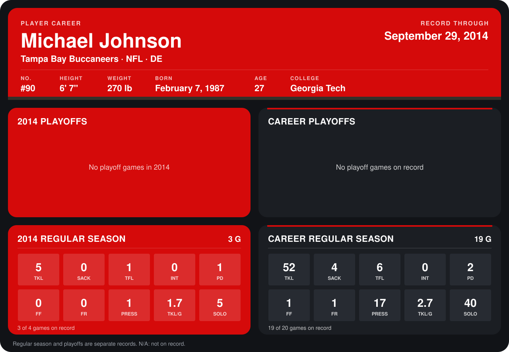

# Michael Johnson

## Career stats

### Regular season

| Season | Club | G | TKL | SACK | TFL | INT | PD | FF | FR | PRESS | TKL/G | SOLO |
|---|---|---:|---:|---:|---:|---:|---:|---:|---:|---:|---:|---:|
| 2013 | Cincinnati Bengals | 16 | 47 | 4 | 5 | 0 | 1 | 1 | 1 | 16 | 2.9 | 35 |
| 2014 | Tampa Bay Buccaneers | 3 | 5 | 0 | 1 | 0 | 1 | 0 | 0 | 1 | 1.7 | 5 |
| **Career** |  | 19 | 52 | 4 | 6 | 0 | 2 | 1 | 1 | 17 | 2.7 | 40 |

### Playoffs

No playoff games on record.

## Awards

None on record.

Records through September 29, 2014. Identity: listed 2014 roster data, Weeks 1-4; number: 2014 Week 1 roster. [All Tampa Bay Buccaneers players](README.md).
