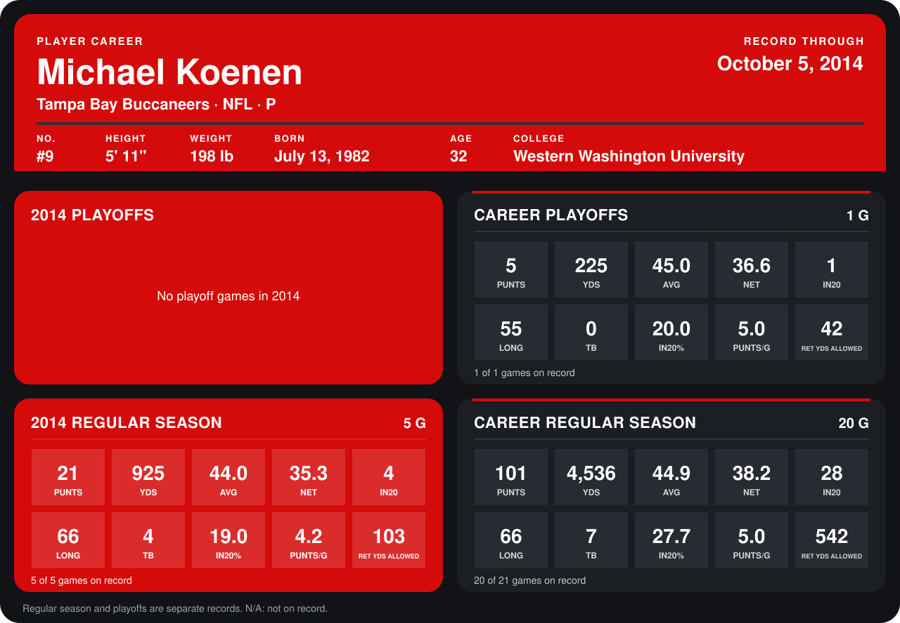

# Michael Koenen

## Career stats

### Regular season

| Season | Club | G | PUNTS | YDS | AVG | NET | IN20 | LONG | TB | IN20% | PUNTS/G | RET YDS ALLOWED |
|---|---|---:|---:|---:|---:|---:|---:|---:|---:|---:|---:|---:|
| 2013 | Tampa Bay Buccaneers | 15 | 80 | 3,611 | 45.1 | 38.9 | 24 | 64 | 3 | 30.0 | 5.3 | 439 |
| 2014 | Tampa Bay Buccaneers | 4 | 16 | 657 | 41.1 | 33.1 | 4 | 53 | 3 | 25.0 | 4.0 | 67 |
| **Career** |  | 19 | 96 | 4,268 | 44.5 | 37.9 | 28 | 64 | 6 | 29.2 | 5.1 | 506 |

### Playoffs

| Season | Club | G | PUNTS | YDS | AVG | NET | IN20 | LONG | TB | IN20% | PUNTS/G | RET YDS ALLOWED |
|---|---|---:|---:|---:|---:|---:|---:|---:|---:|---:|---:|---:|
| 2013 | Tampa Bay Buccaneers | 1 | 5 | 225 | 45.0 | 36.6 | 1 | 55 | 0 | 20.0 | 5.0 | 42 |
| **Career** |  | 1 | 5 | 225 | 45.0 | 36.6 | 1 | 55 | 0 | 20.0 | 5.0 | 42 |

## Awards

None on record.

Records through September 29, 2014. Identity: listed 2014 roster data, Weeks 1-4; number: 2014 Week 1 roster. [All Tampa Bay Buccaneers players](README.md).
