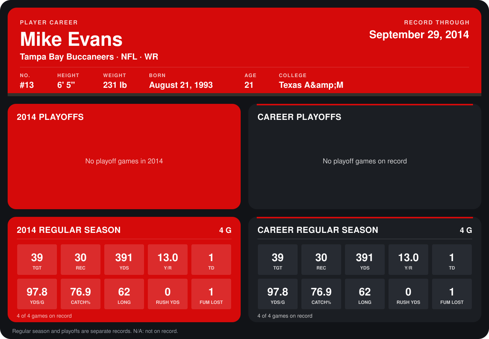

# Mike Evans

## Career stats

### Regular season

| Season | Club | G | TGT | REC | YDS | Y/R | TD | YDS/G | CATCH% | LONG | RUSH YDS | FUM LOST |
|---|---|---:|---:|---:|---:|---:|---:|---:|---:|---:|---:|---:|
| 2014 | Tampa Bay Buccaneers | 4 | 39 | 30 | 391 | 13.0 | 1 | 97.8 | 76.9 | 62 | 0 | 1 |
| **Career** |  | 4 | 39 | 30 | 391 | 13.0 | 1 | 97.8 | 76.9 | 62 | 0 | 1 |

### Playoffs

No playoff games on record.

## Awards

None on record.

Records through September 29, 2014. Identity: listed 2014 roster data, Weeks 1-4; number: 2014 Week 1 roster. [All Tampa Bay Buccaneers players](README.md).
