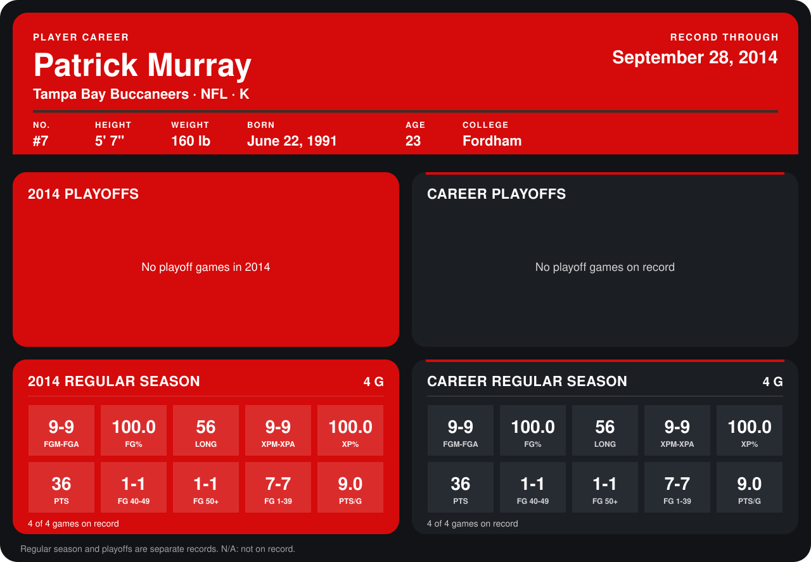

# Patrick Murray

## Career stats

### Regular season

| Season | Club | G | FGM-FGA | FG% | LONG | XPM-XPA | XP% | PTS | FG 40-49 | FG 50+ | FG 1-39 | PTS/G |
|---|---|---:|---:|---:|---:|---:|---:|---:|---:|---:|---:|---:|
| 2014 | Tampa Bay Buccaneers | 5 | 11-12 | 91.7 | 56 | 11-11 | 100.0 | 44 | 1-1 | 1-1 | 9-10 | 8.8 |
| **Career** |  | 5 | 11-12 | 91.7 | 56 | 11-11 | 100.0 | 44 | 1-1 | 1-1 | 9-10 | 8.8 |

### Playoffs

No playoff games on record.

## Awards

None on record.

Records through October 5, 2014. Identity: listed 2014 roster data, Weeks 1-4; number: 2014 Week 1 roster. [All Tampa Bay Buccaneers players](README.md).
