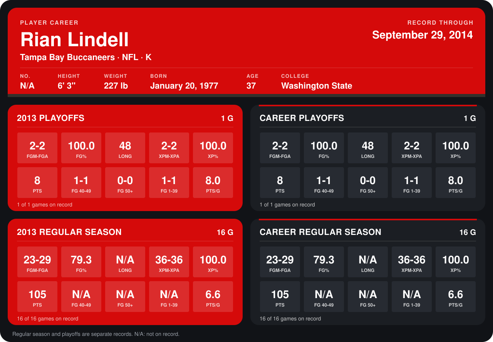

# Rian Lindell

## Career stats

### Regular season

| Season | Team | Age | # | G | FGM-FGA | FG% | LONG | XPM-XPA | XP% | PTS | FG 40-49 | FG 50+ | FG 1-39 | PTS/G |
|---|---|---:|---:|---:|---:|---:|---:|---:|---:|---:|---:|---:|---:|---:|
| 2013 | Tampa Bay Buccaneers | 36 | 4 | 16 | 23-29 | 79.3 | N/A | 36-36 | 100.0 | 105 | N/A | N/A | N/A | 6.6 |
| **Career** |  |  |  | 16 | 23-29 | 79.3 | N/A | 36-36 | 100.0 | 105 | N/A | N/A | N/A | 6.6 |

### Playoffs

| Season | Team | Age | # | G | FGM-FGA | FG% | LONG | XPM-XPA | XP% | PTS | FG 40-49 | FG 50+ | FG 1-39 | PTS/G |
|---|---|---:|---:|---:|---:|---:|---:|---:|---:|---:|---:|---:|---:|---:|
| 2013 | Tampa Bay Buccaneers | 36 | 4 | 1 | 2-2 | 100.0 | 48 | 2-2 | 100.0 | 8 | 1-1 | 0-0 | 1-1 | 8.0 |
| **Career** |  |  |  | 1 | 2-2 | 100.0 | 48 | 2-2 | 100.0 | 8 | 1-1 | 0-0 | 1-1 | 8.0 |

## Awards

None on record.

Age is his age on the league's opening game of each season; # is the number listed for him that season with that team (2014: the card's rule; 2013: the 2013 season roster), N/A where no listing applies.

Records through January 5, 2014. Identity: his listed 2013 season roster data (no 2014 Weeks 1-4 roster row). [All Tampa Bay Buccaneers players](README.md).
