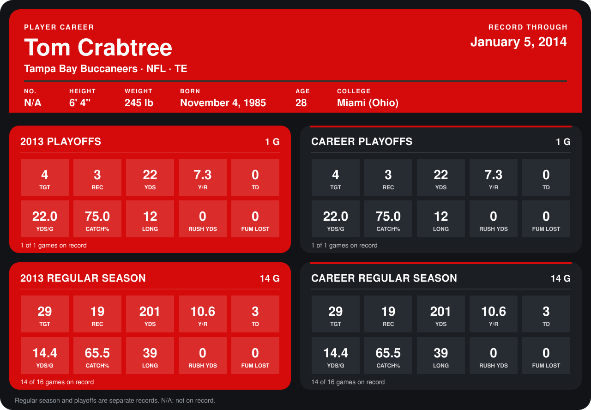

# Tom Crabtree

## Career stats

### Regular season

| Season | Team | Age | # | G | TGT | REC | YDS | Y/R | TD | YDS/G | CATCH% | LONG | RUSH YDS | FUM LOST |
|---|---|---:|---:|---:|---:|---:|---:|---:|---:|---:|---:|---:|---:|---:|
| 2013 | Tampa Bay Buccaneers | 27 | 84 | 14 | 29 | 19 | 201 | 10.6 | 3 | 14.4 | 65.5 | 39 | 0 | 0 |
| **Career** |  |  |  | 14 | 29 | 19 | 201 | 10.6 | 3 | 14.4 | 65.5 | 39 | 0 | 0 |

### Playoffs

| Season | Team | Age | # | G | TGT | REC | YDS | Y/R | TD | YDS/G | CATCH% | LONG | RUSH YDS | FUM LOST |
|---|---|---:|---:|---:|---:|---:|---:|---:|---:|---:|---:|---:|---:|---:|
| 2013 | Tampa Bay Buccaneers | 27 | 84 | 1 | 4 | 3 | 22 | 7.3 | 0 | 22.0 | 75.0 | 12 | 0 | 0 |
| **Career** |  |  |  | 1 | 4 | 3 | 22 | 7.3 | 0 | 22.0 | 75.0 | 12 | 0 | 0 |

## Awards

None on record.

Age is his age on the league's opening game of each season; # is the number listed for him that season with that team (2014: the card's rule; 2013: the 2013 season roster), N/A where no listing applies.

Records through January 5, 2014. Identity: his listed 2013 season roster data (no 2014 Weeks 1-4 roster row). [All Tampa Bay Buccaneers players](README.md).
