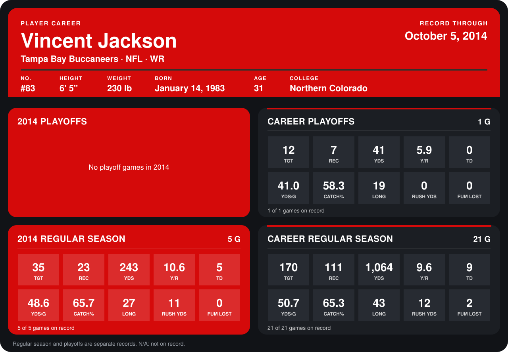

# Vincent Jackson

## Career stats

### Regular season

| Season | Club | G | TGT | REC | YDS | Y/R | TD | YDS/G | CATCH% | LONG | RUSH YDS | FUM LOST |
|---|---|---:|---:|---:|---:|---:|---:|---:|---:|---:|---:|---:|
| 2013 | Tampa Bay Buccaneers | 16 | 135 | 88 | 821 | 9.3 | 4 | 51.3 | 65.2 | 43 | 1 | 2 |
| 2014 | Tampa Bay Buccaneers | 4 | 26 | 17 | 187 | 11.0 | 4 | 46.8 | 65.4 | 27 | 3 | 0 |
| **Career** |  | 20 | 161 | 105 | 1,008 | 9.6 | 8 | 50.4 | 65.2 | 43 | 4 | 2 |

### Playoffs

| Season | Club | G | TGT | REC | YDS | Y/R | TD | YDS/G | CATCH% | LONG | RUSH YDS | FUM LOST |
|---|---|---:|---:|---:|---:|---:|---:|---:|---:|---:|---:|---:|
| 2013 | Tampa Bay Buccaneers | 1 | 12 | 7 | 41 | 5.9 | 0 | 41.0 | 58.3 | 19 | 0 | 0 |
| **Career** |  | 1 | 12 | 7 | 41 | 5.9 | 0 | 41.0 | 58.3 | 19 | 0 | 0 |

## Awards

None on record.

Records through September 28, 2014. Identity: listed 2014 roster data, Weeks 1-4; number: 2014 Week 1 roster. [All Tampa Bay Buccaneers players](README.md).
