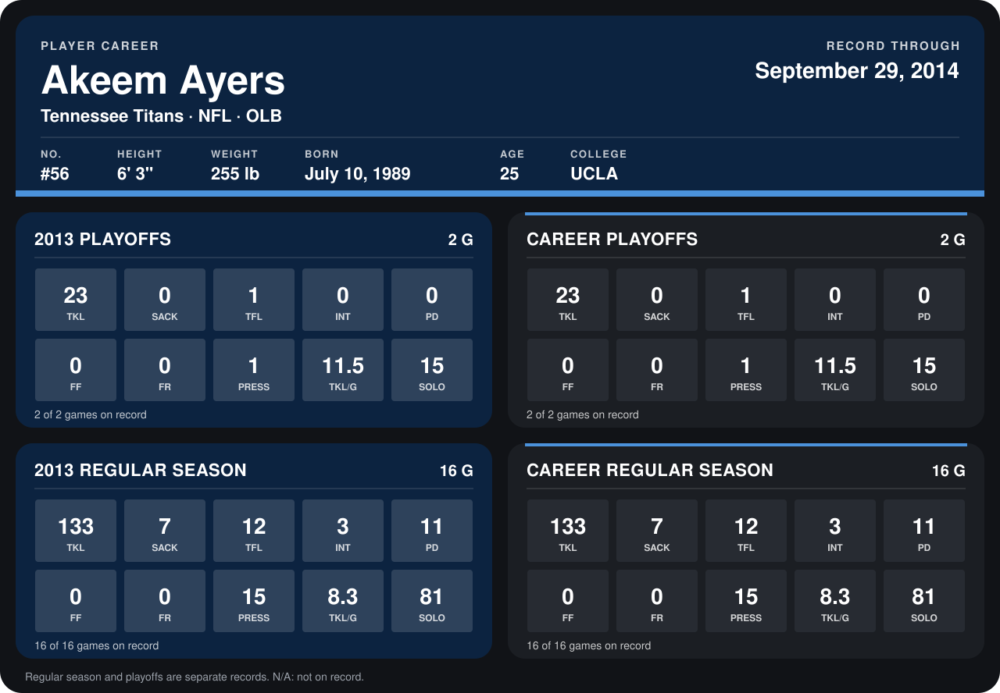

# Akeem Ayers

## Career stats

### Regular season

| Season | Club | G | TKL | SACK | TFL | INT | PD | FF | FR | PRESS | TKL/G | SOLO |
|---|---|---:|---:|---:|---:|---:|---:|---:|---:|---:|---:|---:|
| 2013 | Tennessee Titans | 16 | 133 | 7 | 12 | 3 | 11 | 0 | 0 | 15 | 8.3 | 81 |
| **Career** |  | 16 | 133 | 7 | 12 | 3 | 11 | 0 | 0 | 15 | 8.3 | 81 |

### Playoffs

| Season | Club | G | TKL | SACK | TFL | INT | PD | FF | FR | PRESS | TKL/G | SOLO |
|---|---|---:|---:|---:|---:|---:|---:|---:|---:|---:|---:|---:|
| 2013 | Tennessee Titans | 2 | 23 | 0 | 1 | 0 | 0 | 0 | 0 | 1 | 11.5 | 15 |
| **Career** |  | 2 | 23 | 0 | 1 | 0 | 0 | 0 | 0 | 1 | 11.5 | 15 |

## Awards

- Pro Bowl selection (2013, OLB)

Records through September 29, 2014. Identity: listed 2014 roster data, Weeks 1-4; number: 2014 Week 1 roster. [All Tennessee Titans players](README.md).
