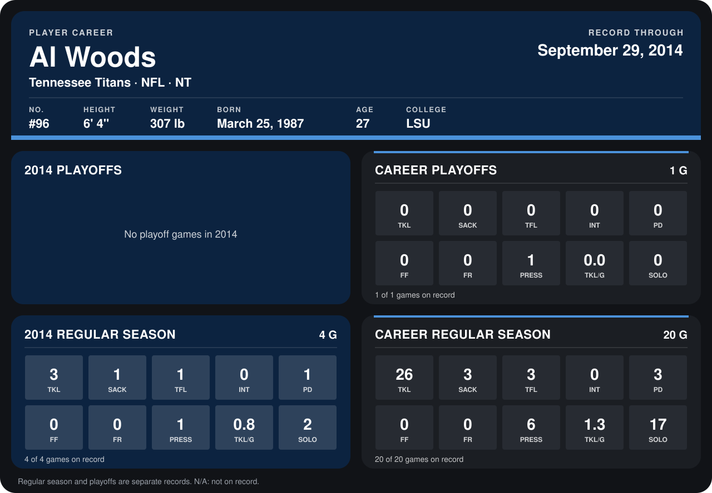

# Al Woods

## Career stats

### Regular season

| Season | Club | G | TKL | SACK | TFL | INT | PD | FF | FR | PRESS | TKL/G | SOLO |
|---|---|---:|---:|---:|---:|---:|---:|---:|---:|---:|---:|---:|
| 2013 | Pittsburgh Steelers | 16 | 23 | 2 | 2 | 0 | 2 | 0 | 0 | 5 | 1.4 | 15 |
| 2014 | Tennessee Titans | 4 | 3 | 1 | 1 | 0 | 1 | 0 | 0 | 1 | 0.8 | 2 |
| **Career** |  | 20 | 26 | 3 | 3 | 0 | 3 | 0 | 0 | 6 | 1.3 | 17 |

### Playoffs

| Season | Club | G | TKL | SACK | TFL | INT | PD | FF | FR | PRESS | TKL/G | SOLO |
|---|---|---:|---:|---:|---:|---:|---:|---:|---:|---:|---:|---:|
| 2013 | Pittsburgh Steelers | 1 | 0 | 0 | 0 | 0 | 0 | 0 | 0 | 1 | 0.0 | 0 |
| **Career** |  | 1 | 0 | 0 | 0 | 0 | 0 | 0 | 0 | 1 | 0.0 | 0 |

## Awards

None on record.

Records through September 29, 2014. Identity: listed 2014 roster data, Weeks 1-4; number: 2014 Week 1 roster. [All Tennessee Titans players](README.md).
