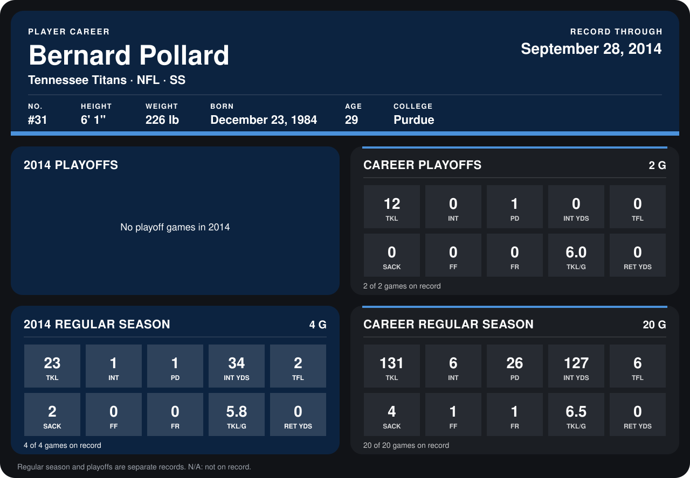

# Bernard Pollard

## Career stats

### Regular season

| Season | Club | G | TKL | INT | PD | INT YDS | TFL | SACK | FF | FR | TKL/G | RET YDS |
|---|---|---:|---:|---:|---:|---:|---:|---:|---:|---:|---:|---:|
| 2013 | Tennessee Titans | 16 | 108 | 5 | 25 | 93 | 4 | 2 | 1 | 1 | 6.8 | 0 |
| 2014 | Tennessee Titans | 5 | 24 | 2 | 2 | 34 | 2 | 2 | 0 | 0 | 4.8 | 0 |
| **Career** |  | 21 | 132 | 7 | 27 | 127 | 6 | 4 | 1 | 1 | 6.3 | 0 |

### Playoffs

| Season | Club | G | TKL | INT | PD | INT YDS | TFL | SACK | FF | FR | TKL/G | RET YDS |
|---|---|---:|---:|---:|---:|---:|---:|---:|---:|---:|---:|---:|
| 2013 | Tennessee Titans | 2 | 12 | 0 | 1 | 0 | 0 | 0 | 0 | 0 | 6.0 | 0 |
| **Career** |  | 2 | 12 | 0 | 1 | 0 | 0 | 0 | 0 | 0 | 6.0 | 0 |

## Awards

- AFC Defensive Player of the Week (2013, Week 3)
- AFC Defensive Player of the Month (2013, September)
- Pro Bowl selection (2013, S)

Records through October 5, 2014. Identity: listed 2014 roster data, Weeks 1-4; number: 2014 Week 1 roster. [All Tennessee Titans players](README.md).
