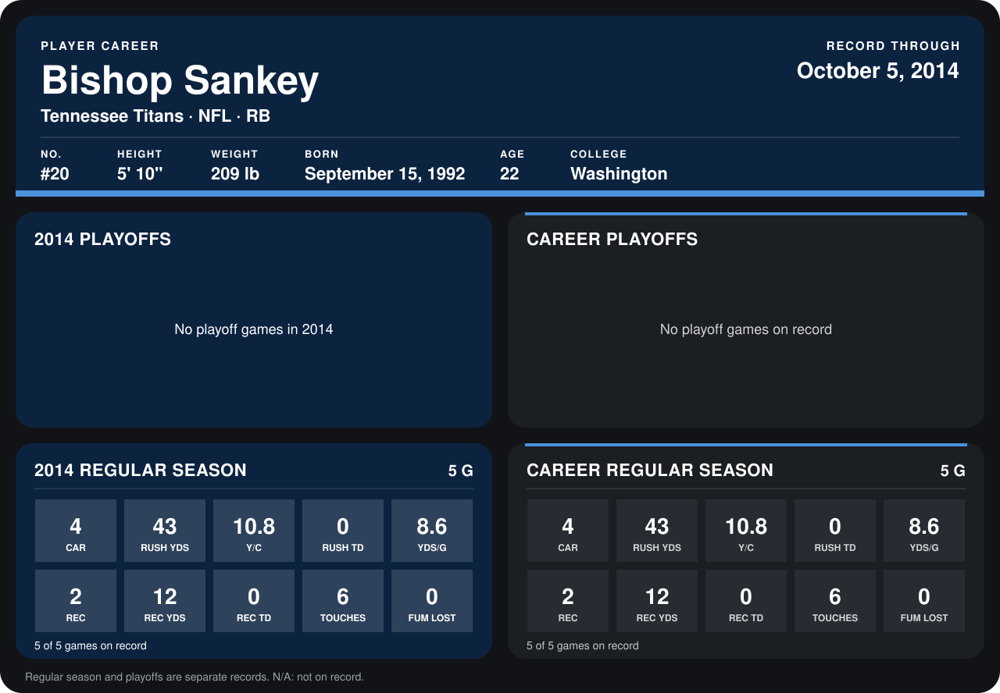

# Bishop Sankey

## Career stats

### Regular season

| Season | Club | G | CAR | RUSH YDS | Y/C | RUSH TD | YDS/G | REC | REC YDS | REC TD | TOUCHES | FUM LOST |
|---|---|---:|---:|---:|---:|---:|---:|---:|---:|---:|---:|---:|
| 2014 | Tennessee Titans | 5 | 4 | 43 | 10.8 | 0 | 8.6 | 2 | 12 | 0 | 6 | 0 |
| **Career** |  | 5 | 4 | 43 | 10.8 | 0 | 8.6 | 2 | 12 | 0 | 6 | 0 |

### Playoffs

No playoff games on record.

## Awards

None on record.

Records through October 5, 2014. Identity: listed 2014 roster data, Weeks 1-4; number: 2014 Week 1 roster. [All Tennessee Titans players](README.md).
