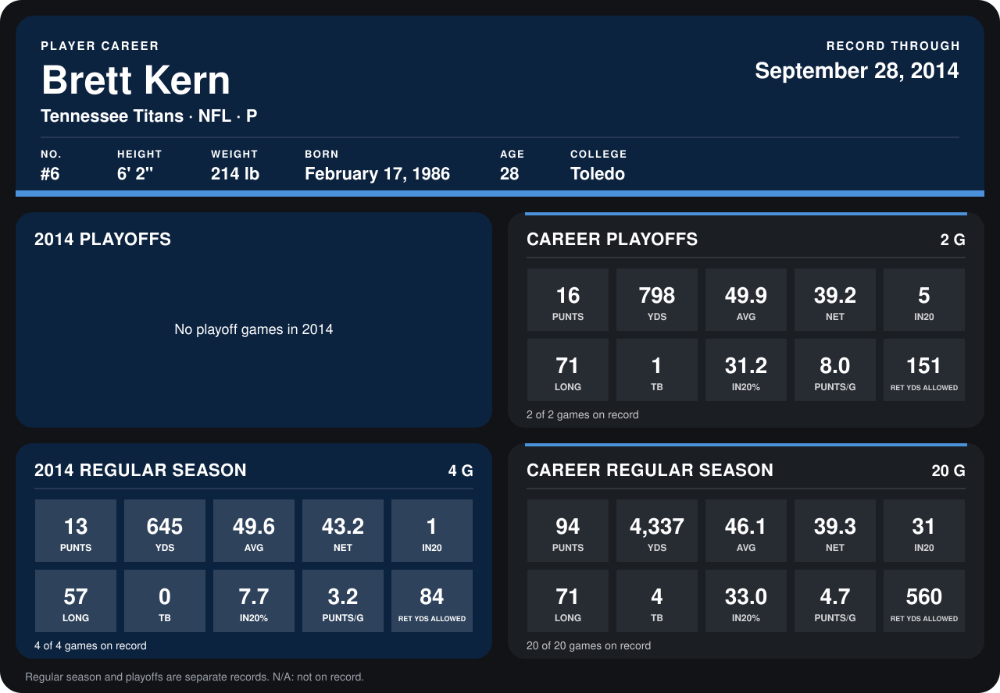

# Brett Kern

## Career stats

### Regular season

| Season | Club | G | PUNTS | YDS | AVG | NET | IN20 | LONG | TB | IN20% | PUNTS/G | RET YDS ALLOWED |
|---|---|---:|---:|---:|---:|---:|---:|---:|---:|---:|---:|---:|
| 2013 | Tennessee Titans | 16 | 81 | 3,692 | 45.6 | 38.7 | 30 | 71 | 4 | 37.0 | 5.1 | 476 |
| 2014 | Tennessee Titans | 4 | 13 | 645 | 49.6 | 43.2 | 1 | 57 | 0 | 7.7 | 3.2 | 84 |
| **Career** |  | 20 | 94 | 4,337 | 46.1 | 39.3 | 31 | 71 | 4 | 33.0 | 4.7 | 560 |

### Playoffs

| Season | Club | G | PUNTS | YDS | AVG | NET | IN20 | LONG | TB | IN20% | PUNTS/G | RET YDS ALLOWED |
|---|---|---:|---:|---:|---:|---:|---:|---:|---:|---:|---:|---:|
| 2013 | Tennessee Titans | 2 | 16 | 798 | 49.9 | 39.2 | 5 | 71 | 1 | 31.2 | 8.0 | 151 |
| **Career** |  | 2 | 16 | 798 | 49.9 | 39.2 | 5 | 71 | 1 | 31.2 | 8.0 | 151 |

## Awards

- AFC Special Teams Player of the Week (2013, Week 12)
- AFC Special Teams Player of the Month (2013, November)

Records through September 28, 2014. Identity: listed 2014 roster data, Weeks 1-4; number: 2014 Week 1 roster. [All Tennessee Titans players](README.md).
