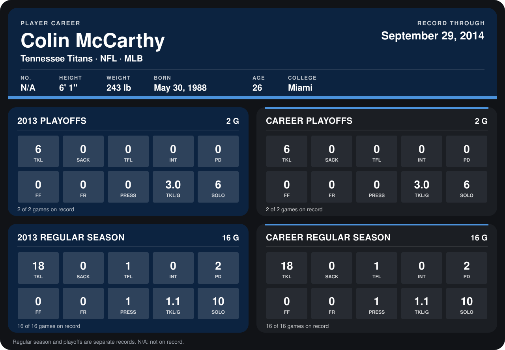

# Colin McCarthy

## Career stats

### Regular season

| Season | Club | G | TKL | SACK | TFL | INT | PD | FF | FR | PRESS | TKL/G | SOLO |
|---|---|---:|---:|---:|---:|---:|---:|---:|---:|---:|---:|---:|
| 2013 | Tennessee Titans | 16 | 18 | 0 | 1 | 0 | 2 | 0 | 0 | 1 | 1.1 | 10 |
| **Career** |  | 16 | 18 | 0 | 1 | 0 | 2 | 0 | 0 | 1 | 1.1 | 10 |

### Playoffs

| Season | Club | G | TKL | SACK | TFL | INT | PD | FF | FR | PRESS | TKL/G | SOLO |
|---|---|---:|---:|---:|---:|---:|---:|---:|---:|---:|---:|---:|
| 2013 | Tennessee Titans | 2 | 6 | 0 | 0 | 0 | 0 | 0 | 0 | 0 | 3.0 | 6 |
| **Career** |  | 2 | 6 | 0 | 0 | 0 | 0 | 0 | 0 | 0 | 3.0 | 6 |

## Awards

None on record.

Records through January 19, 2014. Identity: his listed 2013 season roster data (no 2014 Weeks 1-4 roster row). [All Tennessee Titans players](README.md).
