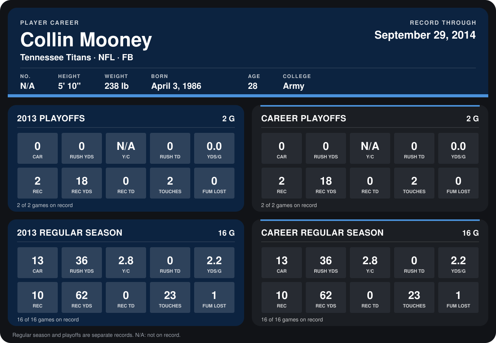

# Collin Mooney

## Career stats

### Regular season

| Season | Team | Age | # | G | CAR | RUSH YDS | Y/C | RUSH TD | YDS/G | REC | REC YDS | REC TD | TOUCHES | FUM LOST |
|---|---|---:|---:|---:|---:|---:|---:|---:|---:|---:|---:|---:|---:|---:|
| 2013 | Tennessee Titans | 27 | 42 | 16 | 13 | 36 | 2.8 | 0 | 2.2 | 10 | 62 | 0 | 23 | 1 |
| **Career** |  |  |  | 16 | 13 | 36 | 2.8 | 0 | 2.2 | 10 | 62 | 0 | 23 | 1 |

### Playoffs

| Season | Team | Age | # | G | CAR | RUSH YDS | Y/C | RUSH TD | YDS/G | REC | REC YDS | REC TD | TOUCHES | FUM LOST |
|---|---|---:|---:|---:|---:|---:|---:|---:|---:|---:|---:|---:|---:|---:|
| 2013 | Tennessee Titans | 27 | 42 | 2 | 0 | 0 | N/A | 0 | 0.0 | 2 | 18 | 0 | 2 | 0 |
| **Career** |  |  |  | 2 | 0 | 0 | N/A | 0 | 0.0 | 2 | 18 | 0 | 2 | 0 |

## Awards

None on record.

Age is his age on the league's opening game of each season; # is the number listed for him that season with that team (2014: the card's rule; 2013: the 2013 season roster), N/A where no listing applies.

Records through January 19, 2014. Identity: his listed 2013 season roster data (no 2014 Weeks 1-4 roster row). [All Tennessee Titans players](README.md).
