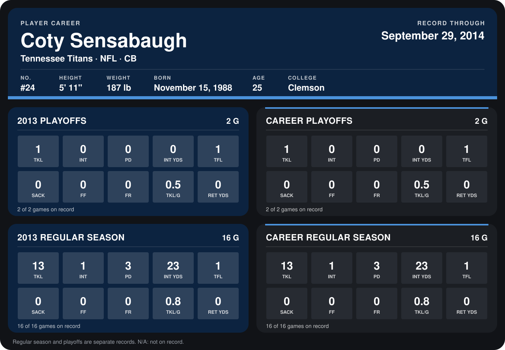

# Coty Sensabaugh

## Career stats

### Regular season

| Season | Club | G | TKL | INT | PD | INT YDS | TFL | SACK | FF | FR | TKL/G | RET YDS |
|---|---|---:|---:|---:|---:|---:|---:|---:|---:|---:|---:|---:|
| 2013 | Tennessee Titans | 16 | 13 | 1 | 3 | 23 | 1 | 0 | 0 | 0 | 0.8 | 0 |
| **Career** |  | 16 | 13 | 1 | 3 | 23 | 1 | 0 | 0 | 0 | 0.8 | 0 |

### Playoffs

| Season | Club | G | TKL | INT | PD | INT YDS | TFL | SACK | FF | FR | TKL/G | RET YDS |
|---|---|---:|---:|---:|---:|---:|---:|---:|---:|---:|---:|---:|
| 2013 | Tennessee Titans | 2 | 1 | 0 | 0 | 0 | 1 | 0 | 0 | 0 | 0.5 | 0 |
| **Career** |  | 2 | 1 | 0 | 0 | 0 | 1 | 0 | 0 | 0 | 0.5 | 0 |

## Awards

None on record.

Records through January 19, 2014. Identity: listed 2014 roster data, Weeks 1-4; number: 2014 Week 4 roster listing. [All Tennessee Titans players](README.md).
