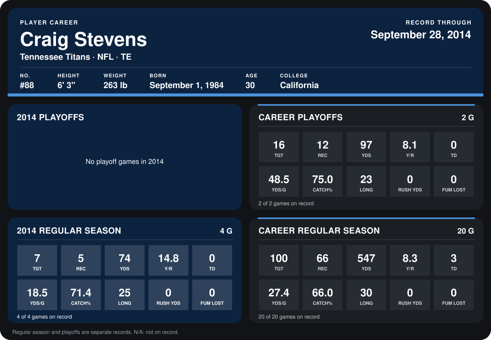

# Craig Stevens

## Career stats

### Regular season

| Season | Team | Age | # | G | TGT | REC | YDS | Y/R | TD | YDS/G | CATCH% | LONG | RUSH YDS | FUM LOST |
|---|---|---:|---:|---:|---:|---:|---:|---:|---:|---:|---:|---:|---:|---:|
| 2013 | Tennessee Titans | 29 | 88 | 16 | 93 | 61 | 473 | 7.8 | 3 | 29.6 | 65.6 | 30 | 0 | 0 |
| 2014 | Tennessee Titans | 30 | 88 | 4 | 7 | 5 | 74 | 14.8 | 0 | 18.5 | 71.4 | 25 | 0 | 0 |
| **Career** |  |  |  | 20 | 100 | 66 | 547 | 8.3 | 3 | 27.4 | 66.0 | 30 | 0 | 0 |

### Playoffs

| Season | Team | Age | # | G | TGT | REC | YDS | Y/R | TD | YDS/G | CATCH% | LONG | RUSH YDS | FUM LOST |
|---|---|---:|---:|---:|---:|---:|---:|---:|---:|---:|---:|---:|---:|---:|
| 2013 | Tennessee Titans | 29 | 88 | 2 | 16 | 12 | 97 | 8.1 | 0 | 48.5 | 75.0 | 23 | 0 | 0 |
| **Career** |  |  |  | 2 | 16 | 12 | 97 | 8.1 | 0 | 48.5 | 75.0 | 23 | 0 | 0 |

## Awards

None on record.

Age is his age on the league's opening game of each season; # is the number listed for him that season with that team (2014: the card's rule; 2013: the 2013 season roster), N/A where no listing applies.

Records through September 28, 2014. Identity: listed 2014 roster data, Weeks 1-4; number: 2014 Week 1 roster. [All Tennessee Titans players](README.md).
