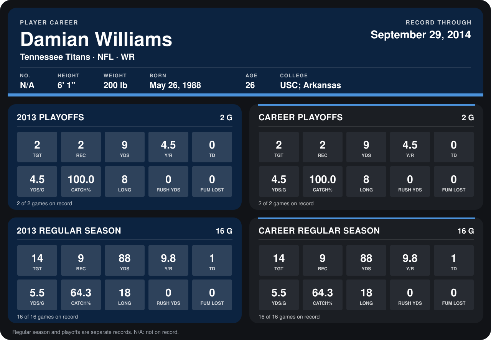

# Damian Williams

## Career stats

### Regular season

| Season | Team | Age | # | G | TGT | REC | YDS | Y/R | TD | YDS/G | CATCH% | LONG | RUSH YDS | FUM LOST |
|---|---|---:|---:|---:|---:|---:|---:|---:|---:|---:|---:|---:|---:|---:|
| 2013 | Tennessee Titans | 25 | 17 | 16 | 14 | 9 | 88 | 9.8 | 1 | 5.5 | 64.3 | 18 | 0 | 0 |
| **Career** |  |  |  | 16 | 14 | 9 | 88 | 9.8 | 1 | 5.5 | 64.3 | 18 | 0 | 0 |

### Playoffs

| Season | Team | Age | # | G | TGT | REC | YDS | Y/R | TD | YDS/G | CATCH% | LONG | RUSH YDS | FUM LOST |
|---|---|---:|---:|---:|---:|---:|---:|---:|---:|---:|---:|---:|---:|---:|
| 2013 | Tennessee Titans | 25 | 17 | 2 | 2 | 2 | 9 | 4.5 | 0 | 4.5 | 100.0 | 8 | 0 | 0 |
| **Career** |  |  |  | 2 | 2 | 2 | 9 | 4.5 | 0 | 4.5 | 100.0 | 8 | 0 | 0 |

## Awards

None on record.

Age is his age on the league's opening game of each season; # is the number listed for him that season with that team (2014: the card's rule; 2013: the 2013 season roster), N/A where no listing applies.

Records through January 19, 2014. Identity: his listed 2013 season roster data (no 2014 Weeks 1-4 roster row). [All Tennessee Titans players](README.md).
