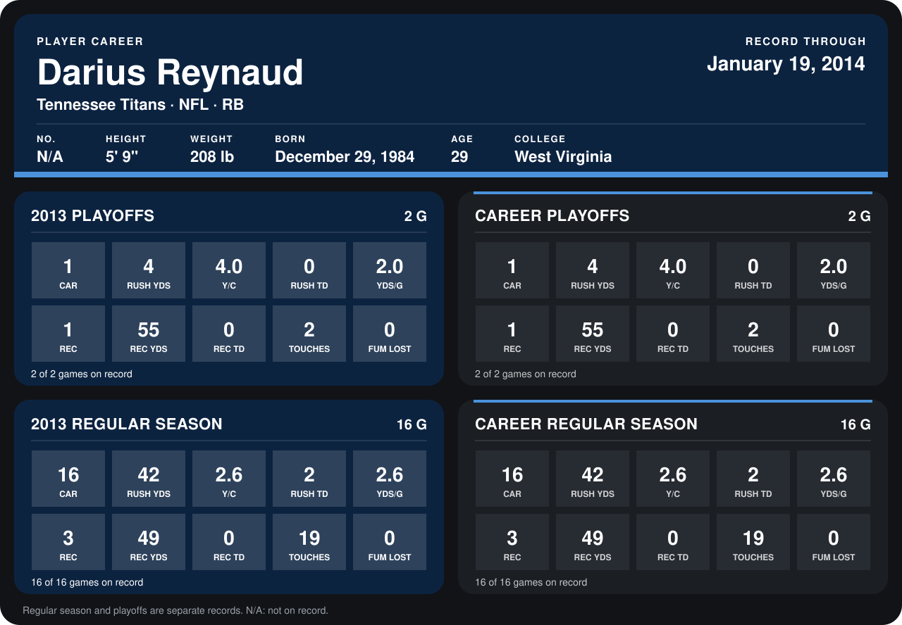

# Darius Reynaud

## Career stats

### Regular season

| Season | Club | G | CAR | RUSH YDS | Y/C | RUSH TD | YDS/G | REC | REC YDS | REC TD | TOUCHES | FUM LOST |
|---|---|---:|---:|---:|---:|---:|---:|---:|---:|---:|---:|---:|
| 2013 | Tennessee Titans | 16 | 16 | 42 | 2.6 | 2 | 2.6 | 3 | 49 | 0 | 19 | 0 |
| **Career** |  | 16 | 16 | 42 | 2.6 | 2 | 2.6 | 3 | 49 | 0 | 19 | 0 |

### Playoffs

| Season | Club | G | CAR | RUSH YDS | Y/C | RUSH TD | YDS/G | REC | REC YDS | REC TD | TOUCHES | FUM LOST |
|---|---|---:|---:|---:|---:|---:|---:|---:|---:|---:|---:|---:|
| 2013 | Tennessee Titans | 2 | 1 | 4 | 4.0 | 0 | 2.0 | 1 | 55 | 0 | 2 | 0 |
| **Career** |  | 2 | 1 | 4 | 4.0 | 0 | 2.0 | 1 | 55 | 0 | 2 | 0 |

## Awards

- AFC Special Teams Player of the Week (2013, Week 16)

Records through January 19, 2014. Identity: his listed 2013 season roster data (no 2014 Weeks 1-4 roster row). [All Tennessee Titans players](README.md).
