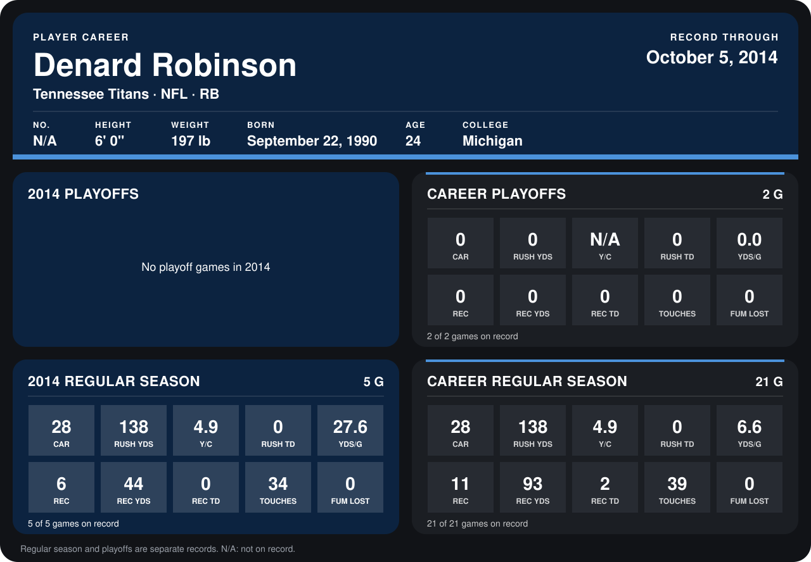

# Denard Robinson

## Career stats

### Regular season

| Season | Team | Age | # | G | CAR | RUSH YDS | Y/C | RUSH TD | YDS/G | REC | REC YDS | REC TD | TOUCHES | FUM LOST |
|---|---|---:|---:|---:|---:|---:|---:|---:|---:|---:|---:|---:|---:|---:|
| 2013 | Tennessee Titans | 22 | N/A | 16 | 0 | 0 | N/A | 0 | 0.0 | 5 | 49 | 2 | 5 | 0 |
| 2014 | Tennessee Titans | 23 | N/A | 4 | 18 | 84 | 4.7 | 0 | 21.0 | 3 | 28 | 0 | 21 | 0 |
| **Career** |  |  |  | 20 | 18 | 84 | 4.7 | 0 | 4.2 | 8 | 77 | 2 | 26 | 0 |

### Playoffs

| Season | Team | Age | # | G | CAR | RUSH YDS | Y/C | RUSH TD | YDS/G | REC | REC YDS | REC TD | TOUCHES | FUM LOST |
|---|---|---:|---:|---:|---:|---:|---:|---:|---:|---:|---:|---:|---:|---:|
| 2013 | Tennessee Titans | 22 | N/A | 2 | 0 | 0 | N/A | 0 | 0.0 | 0 | 0 | 0 | 0 | 0 |
| **Career** |  |  |  | 2 | 0 | 0 | N/A | 0 | 0.0 | 0 | 0 | 0 | 0 | 0 |

## Awards

None on record.

Age is his age on the league's opening game of each season; # is the number listed for him that season with that team (2014: the card's rule; 2013: the 2013 season roster), N/A where no listing applies.

Records through September 28, 2014. Identity: listed 2014 roster data, Weeks 1-4. [All Tennessee Titans players](README.md).
