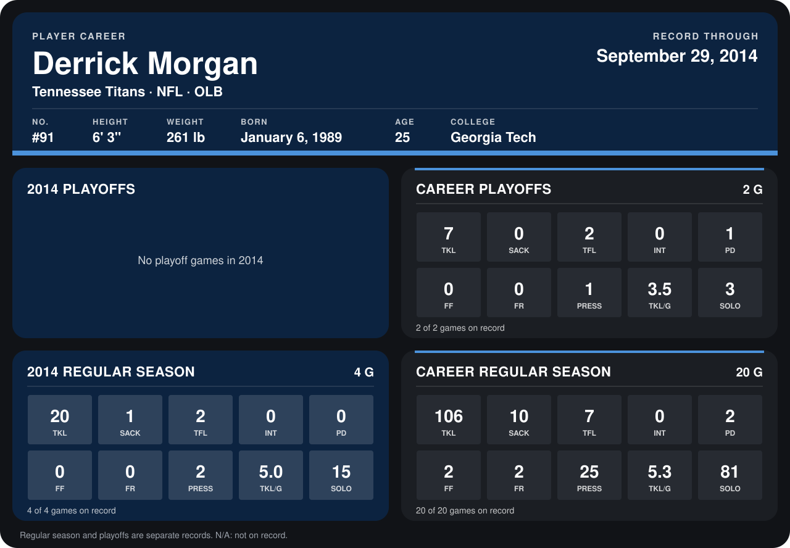

# Derrick Morgan

## Career stats

### Regular season

| Season | Club | G | TKL | SACK | TFL | INT | PD | FF | FR | PRESS | TKL/G | SOLO |
|---|---|---:|---:|---:|---:|---:|---:|---:|---:|---:|---:|---:|
| 2013 | Tennessee Titans | 16 | 86 | 9 | 5 | 0 | 2 | 2 | 2 | 23 | 5.4 | 66 |
| 2014 | Tennessee Titans | 5 | 23 | 1 | 3 | 0 | 0 | 0 | 0 | 2 | 4.6 | 17 |
| **Career** |  | 21 | 109 | 10 | 8 | 0 | 2 | 2 | 2 | 25 | 5.2 | 83 |

### Playoffs

| Season | Club | G | TKL | SACK | TFL | INT | PD | FF | FR | PRESS | TKL/G | SOLO |
|---|---|---:|---:|---:|---:|---:|---:|---:|---:|---:|---:|---:|
| 2013 | Tennessee Titans | 2 | 7 | 0 | 2 | 0 | 1 | 0 | 0 | 1 | 3.5 | 3 |
| **Career** |  | 2 | 7 | 0 | 2 | 0 | 1 | 0 | 0 | 1 | 3.5 | 3 |

## Awards

None on record.

Records through October 5, 2014. Identity: listed 2014 roster data, Weeks 1-4; number: 2014 Week 1 roster. [All Tennessee Titans players](README.md).
