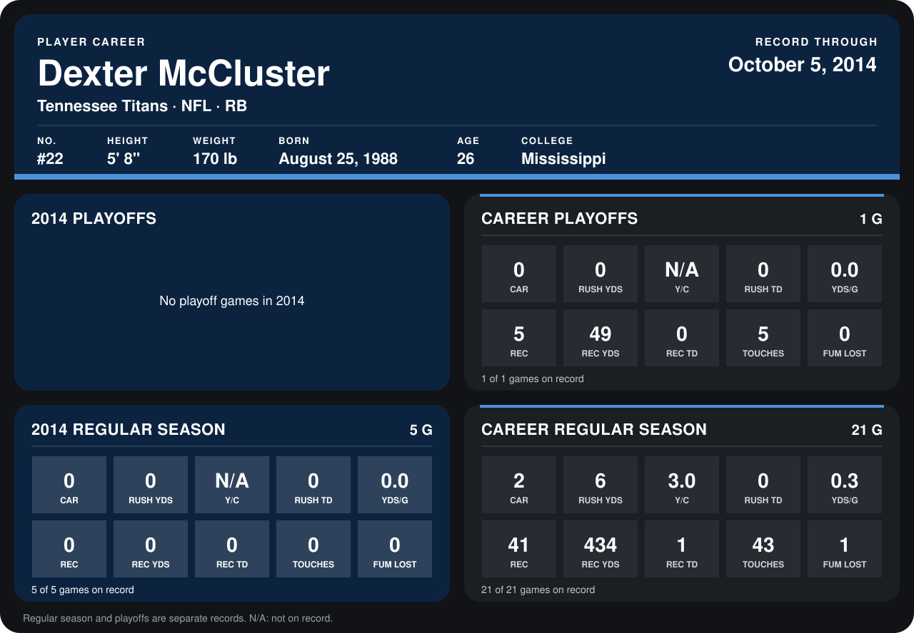

# Dexter McCluster

## Career stats

### Regular season

| Season | Club | G | CAR | RUSH YDS | Y/C | RUSH TD | YDS/G | REC | REC YDS | REC TD | TOUCHES | FUM LOST |
|---|---|---:|---:|---:|---:|---:|---:|---:|---:|---:|---:|---:|
| 2013 | Kansas City Chiefs | 16 | 2 | 6 | 3.0 | 0 | 0.4 | 41 | 434 | 1 | 43 | 1 |
| 2014 | Tennessee Titans | 4 | 0 | 0 | N/A | 0 | 0.0 | 0 | 0 | 0 | 0 | 0 |
| **Career** |  | 20 | 2 | 6 | 3.0 | 0 | 0.3 | 41 | 434 | 1 | 43 | 1 |

### Playoffs

| Season | Club | G | CAR | RUSH YDS | Y/C | RUSH TD | YDS/G | REC | REC YDS | REC TD | TOUCHES | FUM LOST |
|---|---|---:|---:|---:|---:|---:|---:|---:|---:|---:|---:|---:|
| 2013 | Kansas City Chiefs | 1 | 0 | 0 | N/A | 0 | 0.0 | 5 | 49 | 0 | 5 | 0 |
| **Career** |  | 1 | 0 | 0 | N/A | 0 | 0.0 | 5 | 49 | 0 | 5 | 0 |

## Awards

None on record.

Records through September 29, 2014. Identity: listed 2014 roster data, Weeks 1-4; number: 2014 Week 1 roster. [All Tennessee Titans players](README.md).
