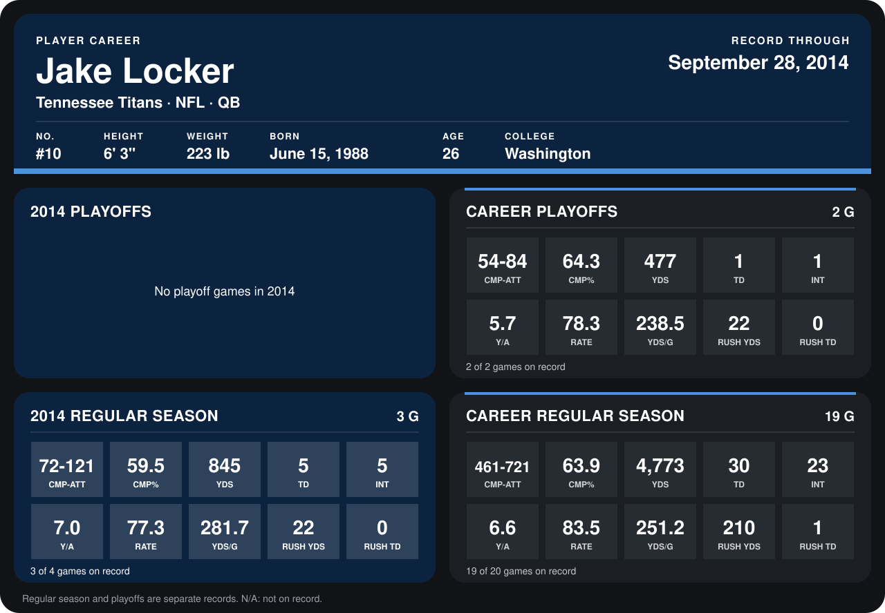

# Jake Locker

## Career stats

### Regular season

| Season | Team | Age | # | G | CMP-ATT | CMP% | YDS | TD | INT | Y/A | RATE | YDS/G | RUSH YDS | RUSH TD |
|---|---|---:|---:|---:|---:|---:|---:|---:|---:|---:|---:|---:|---:|---:|
| 2013 | Tennessee Titans | 25 | 10 | 16 | 389-600 | 64.8 | 3,928 | 25 | 18 | 6.5 | 84.8 | 245.5 | 188 | 1 |
| 2014 | Tennessee Titans | 26 | 10 | 3 | 72-121 | 59.5 | 845 | 5 | 5 | 7.0 | 77.3 | 281.7 | 22 | 0 |
| **Career** |  |  |  | 19 | 461-721 | 63.9 | 4,773 | 30 | 23 | 6.6 | 83.5 | 251.2 | 210 | 1 |

### Playoffs

| Season | Team | Age | # | G | CMP-ATT | CMP% | YDS | TD | INT | Y/A | RATE | YDS/G | RUSH YDS | RUSH TD |
|---|---|---:|---:|---:|---:|---:|---:|---:|---:|---:|---:|---:|---:|---:|
| 2013 | Tennessee Titans | 25 | 10 | 2 | 54-84 | 64.3 | 477 | 1 | 1 | 5.7 | 78.3 | 238.5 | 22 | 0 |
| **Career** |  |  |  | 2 | 54-84 | 64.3 | 477 | 1 | 1 | 5.7 | 78.3 | 238.5 | 22 | 0 |

## Awards

- AFC Offensive Player of the Week (2013, Week 5)

Age is his age on the league's opening game of each season; # is the number listed for him that season with that team (2014: the card's rule; 2013: the 2013 season roster), N/A where no listing applies.

Records through September 28, 2014. Identity: listed 2014 roster data, Weeks 1-4; number: 2014 Week 1 roster. [All Tennessee Titans players](README.md).
