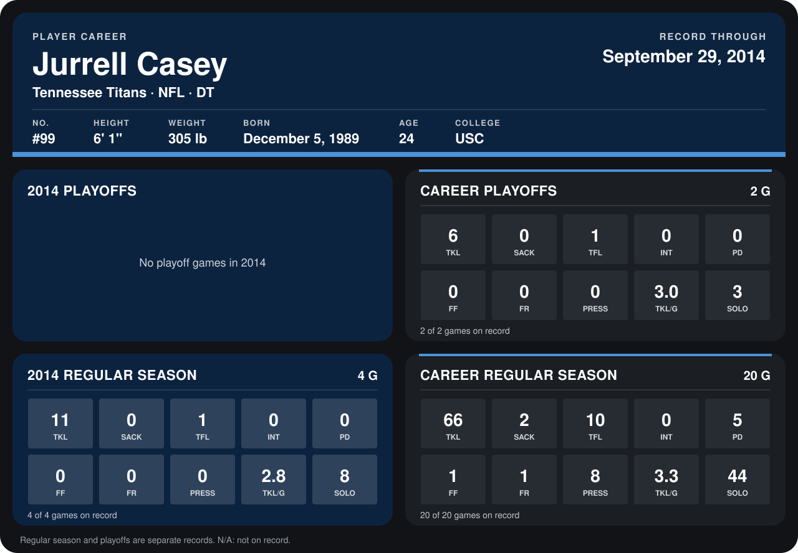

# Jurrell Casey

## Career stats

### Regular season

| Season | Club | G | TKL | SACK | TFL | INT | PD | FF | FR | PRESS | TKL/G | SOLO |
|---|---|---:|---:|---:|---:|---:|---:|---:|---:|---:|---:|---:|
| 2013 | Tennessee Titans | 16 | 55 | 2 | 9 | 0 | 5 | 1 | 1 | 8 | 3.4 | 36 |
| 2014 | Tennessee Titans | 5 | 14 | 0 | 3 | 0 | 0 | 0 | 0 | 0 | 2.8 | 11 |
| **Career** |  | 21 | 69 | 2 | 12 | 0 | 5 | 1 | 1 | 8 | 3.3 | 47 |

### Playoffs

| Season | Club | G | TKL | SACK | TFL | INT | PD | FF | FR | PRESS | TKL/G | SOLO |
|---|---|---:|---:|---:|---:|---:|---:|---:|---:|---:|---:|---:|
| 2013 | Tennessee Titans | 2 | 6 | 0 | 1 | 0 | 0 | 0 | 0 | 0 | 3.0 | 3 |
| **Career** |  | 2 | 6 | 0 | 1 | 0 | 0 | 0 | 0 | 0 | 3.0 | 3 |

## Awards

None on record.

Records through October 5, 2014. Identity: listed 2014 roster data, Weeks 1-4; number: 2014 Week 1 roster. [All Tennessee Titans players](README.md).
