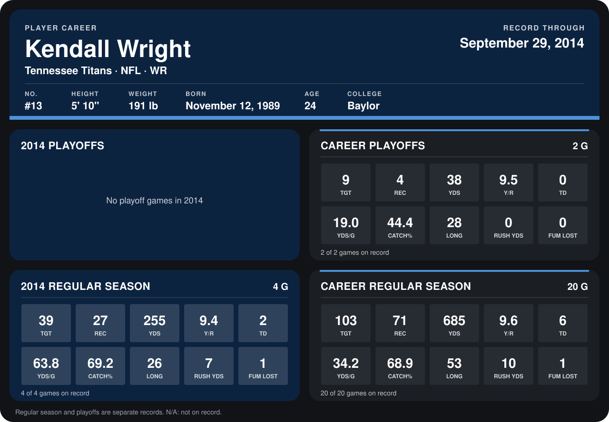

# Kendall Wright

## Career stats

### Regular season

| Season | Club | G | TGT | REC | YDS | Y/R | TD | YDS/G | CATCH% | LONG | RUSH YDS | FUM LOST |
|---|---|---:|---:|---:|---:|---:|---:|---:|---:|---:|---:|---:|
| 2013 | Tennessee Titans | 16 | 64 | 44 | 430 | 9.8 | 4 | 26.9 | 68.8 | 53 | 3 | 0 |
| 2014 | Tennessee Titans | 5 | 48 | 33 | 288 | 8.7 | 3 | 57.6 | 68.8 | 26 | 33 | 1 |
| **Career** |  | 21 | 112 | 77 | 718 | 9.3 | 7 | 34.2 | 68.8 | 53 | 36 | 1 |

### Playoffs

| Season | Club | G | TGT | REC | YDS | Y/R | TD | YDS/G | CATCH% | LONG | RUSH YDS | FUM LOST |
|---|---|---:|---:|---:|---:|---:|---:|---:|---:|---:|---:|---:|
| 2013 | Tennessee Titans | 2 | 9 | 4 | 38 | 9.5 | 0 | 19.0 | 44.4 | 28 | 0 | 0 |
| **Career** |  | 2 | 9 | 4 | 38 | 9.5 | 0 | 19.0 | 44.4 | 28 | 0 | 0 |

## Awards

None on record.

Records through October 5, 2014. Identity: listed 2014 roster data, Weeks 1-4; number: 2014 Week 1 roster. [All Tennessee Titans players](README.md).
