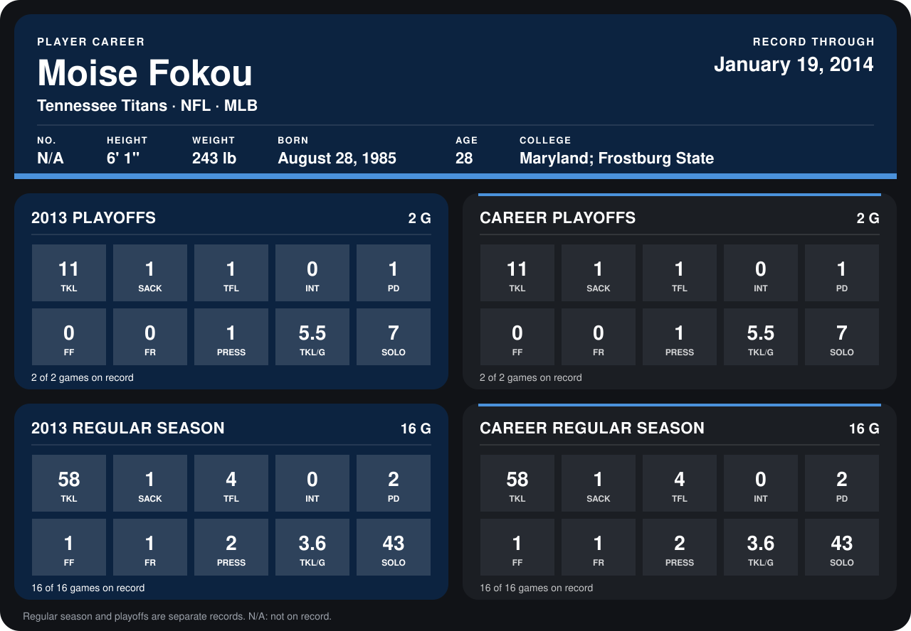

# Moise Fokou

## Career stats

### Regular season

| Season | Club | G | TKL | SACK | TFL | INT | PD | FF | FR | PRESS | TKL/G | SOLO |
|---|---|---:|---:|---:|---:|---:|---:|---:|---:|---:|---:|---:|
| 2013 | Tennessee Titans | 16 | 58 | 1 | 4 | 0 | 2 | 1 | 1 | 2 | 3.6 | 43 |
| **Career** |  | 16 | 58 | 1 | 4 | 0 | 2 | 1 | 1 | 2 | 3.6 | 43 |

### Playoffs

| Season | Club | G | TKL | SACK | TFL | INT | PD | FF | FR | PRESS | TKL/G | SOLO |
|---|---|---:|---:|---:|---:|---:|---:|---:|---:|---:|---:|---:|
| 2013 | Tennessee Titans | 2 | 11 | 1 | 1 | 0 | 1 | 0 | 0 | 1 | 5.5 | 7 |
| **Career** |  | 2 | 11 | 1 | 1 | 0 | 1 | 0 | 0 | 1 | 5.5 | 7 |

## Awards

None on record.

Records through September 29, 2014. Identity: the public player file's latest listing (no 2014 Weeks 1-4 roster row). [All Tennessee Titans players](README.md).
