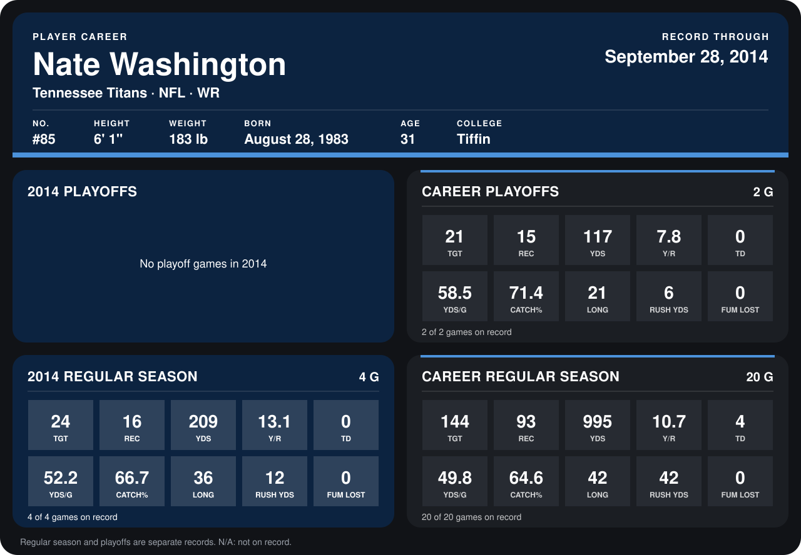

# Nate Washington

## Career stats

### Regular season

| Season | Team | Age | # | G | TGT | REC | YDS | Y/R | TD | YDS/G | CATCH% | LONG | RUSH YDS | FUM LOST |
|---|---|---:|---:|---:|---:|---:|---:|---:|---:|---:|---:|---:|---:|---:|
| 2013 | Tennessee Titans | 30 | 85 | 16 | 120 | 77 | 786 | 10.2 | 4 | 49.1 | 64.2 | 42 | 30 | 0 |
| 2014 | Tennessee Titans | 31 | 85 | 4 | 24 | 16 | 209 | 13.1 | 0 | 52.2 | 66.7 | 36 | 12 | 0 |
| **Career** |  |  |  | 20 | 144 | 93 | 995 | 10.7 | 4 | 49.8 | 64.6 | 42 | 42 | 0 |

### Playoffs

| Season | Team | Age | # | G | TGT | REC | YDS | Y/R | TD | YDS/G | CATCH% | LONG | RUSH YDS | FUM LOST |
|---|---|---:|---:|---:|---:|---:|---:|---:|---:|---:|---:|---:|---:|---:|
| 2013 | Tennessee Titans | 30 | 85 | 2 | 21 | 15 | 117 | 7.8 | 0 | 58.5 | 71.4 | 21 | 6 | 0 |
| **Career** |  |  |  | 2 | 21 | 15 | 117 | 7.8 | 0 | 58.5 | 71.4 | 21 | 6 | 0 |

## Awards

None on record.

Age is his age on the league's opening game of each season; # is the number listed for him that season with that team (2014: the card's rule; 2013: the 2013 season roster), N/A where no listing applies.

Records through September 28, 2014. Identity: listed 2014 roster data, Weeks 1-4; number: 2014 Week 1 roster. [All Tennessee Titans players](README.md).
