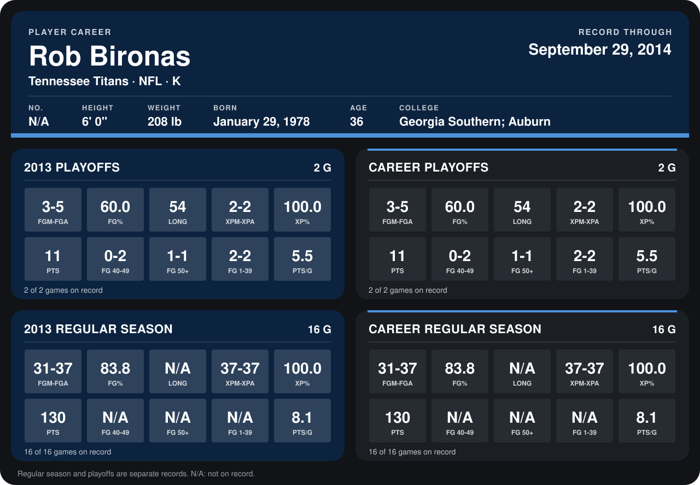

# Rob Bironas

## Career stats

### Regular season

| Season | Club | G | FGM-FGA | FG% | LONG | XPM-XPA | XP% | PTS | FG 40-49 | FG 50+ | FG 1-39 | PTS/G |
|---|---|---:|---:|---:|---:|---:|---:|---:|---:|---:|---:|---:|
| 2013 | Tennessee Titans | 16 | 31-37 | 83.8 | N/A | 37-37 | 100.0 | 130 | N/A | N/A | N/A | 8.1 |
| **Career** |  | 16 | 31-37 | 83.8 | N/A | 37-37 | 100.0 | 130 | N/A | N/A | N/A | 8.1 |

### Playoffs

| Season | Club | G | FGM-FGA | FG% | LONG | XPM-XPA | XP% | PTS | FG 40-49 | FG 50+ | FG 1-39 | PTS/G |
|---|---|---:|---:|---:|---:|---:|---:|---:|---:|---:|---:|---:|
| 2013 | Tennessee Titans | 2 | 3-5 | 60.0 | 54 | 2-2 | 100.0 | 11 | 0-2 | 1-1 | 2-2 | 5.5 |
| **Career** |  | 2 | 3-5 | 60.0 | 54 | 2-2 | 100.0 | 11 | 0-2 | 1-1 | 2-2 | 5.5 |

## Awards

None on record.

Records through September 29, 2014. Identity: the public player file's latest listing (no 2014 Weeks 1-4 roster row). [All Tennessee Titans players](README.md).
