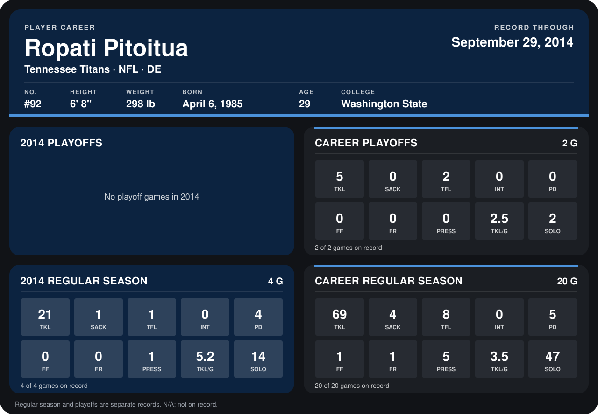

# Ropati Pitoitua

## Career stats

### Regular season

| Season | Team | Age | # | G | TKL | SACK | TFL | INT | PD | FF | FR | PRESS | TKL/G | SOLO |
|---|---|---:|---:|---:|---:|---:|---:|---:|---:|---:|---:|---:|---:|---:|
| 2013 | Tennessee Titans | 28 | 92 | 16 | 48 | 3 | 7 | 0 | 1 | 1 | 1 | 4 | 3.0 | 33 |
| 2014 | Tennessee Titans | 29 | 92 | 5 | 26 | 1 | 2 | 0 | 5 | 0 | 0 | 2 | 5.2 | 19 |
| **Career** |  |  |  | 21 | 74 | 4 | 9 | 0 | 6 | 1 | 1 | 6 | 3.5 | 52 |

### Playoffs

| Season | Team | Age | # | G | TKL | SACK | TFL | INT | PD | FF | FR | PRESS | TKL/G | SOLO |
|---|---|---:|---:|---:|---:|---:|---:|---:|---:|---:|---:|---:|---:|---:|
| 2013 | Tennessee Titans | 28 | 92 | 2 | 5 | 0 | 2 | 0 | 0 | 0 | 0 | 0 | 2.5 | 2 |
| **Career** |  |  |  | 2 | 5 | 0 | 2 | 0 | 0 | 0 | 0 | 0 | 2.5 | 2 |

## Awards

None on record.

Age is his age on the league's opening game of each season; # is the number listed for him that season with that team (2014: the card's rule; 2013: the 2013 season roster), N/A where no listing applies.

Records through October 5, 2014. Identity: listed 2014 roster data, Weeks 1-4; number: 2014 Week 1 roster. [All Tennessee Titans players](README.md).
