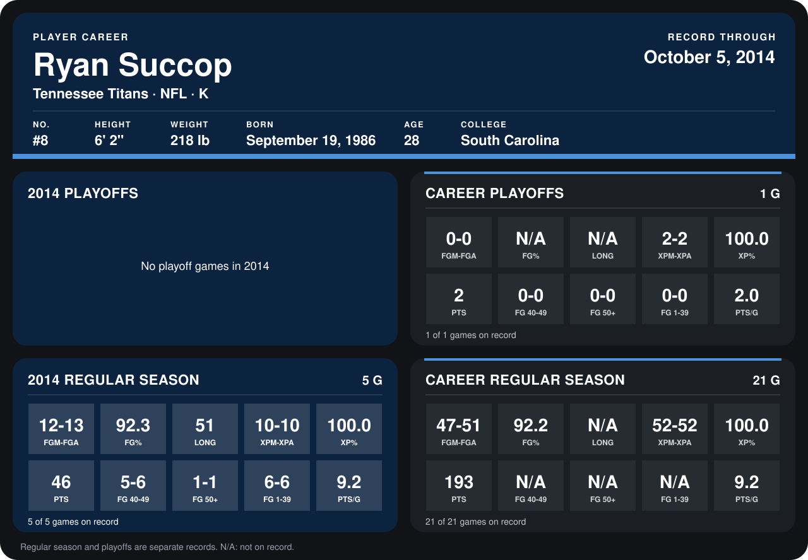

# Ryan Succop

## Career stats

### Regular season

| Season | Team | Age | # | G | FGM-FGA | FG% | LONG | XPM-XPA | XP% | PTS | FG 40-49 | FG 50+ | FG 1-39 | PTS/G |
|---|---|---:|---:|---:|---:|---:|---:|---:|---:|---:|---:|---:|---:|---:|
| 2013 | Kansas City Chiefs | 26 | 6 | 16 | 35-38 | 92.1 | N/A | 42-42 | 100.0 | 147 | N/A | N/A | N/A | 9.2 |
| 2014 | Tennessee Titans | 27 | 8 | 5 | 12-13 | 92.3 | 51 | 10-10 | 100.0 | 46 | 5-6 | 1-1 | 6-6 | 9.2 |
| **Career** |  |  |  | 21 | 47-51 | 92.2 | N/A | 52-52 | 100.0 | 193 | N/A | N/A | N/A | 9.2 |

### Playoffs

| Season | Team | Age | # | G | FGM-FGA | FG% | LONG | XPM-XPA | XP% | PTS | FG 40-49 | FG 50+ | FG 1-39 | PTS/G |
|---|---|---:|---:|---:|---:|---:|---:|---:|---:|---:|---:|---:|---:|---:|
| 2013 | Kansas City Chiefs | 26 | 6 | 1 | 0-0 | N/A | N/A | 2-2 | 100.0 | 2 | 0-0 | 0-0 | 0-0 | 2.0 |
| **Career** |  |  |  | 1 | 0-0 | N/A | N/A | 2-2 | 100.0 | 2 | 0-0 | 0-0 | 0-0 | 2.0 |

## Awards

- AFC Special Teams Player of the Week (2013, Week 9)
- AP First-Team All-Pro (2013, K)
- Pro Bowl selection (2013, K)

Age is his age on the league's opening game of each season; # is the number listed for him that season with that team (2014: the card's rule; 2013: the 2013 season roster), N/A where no listing applies.

Records through October 5, 2014. Identity: listed 2014 roster data, Weeks 1-4; number: 2014 Week 1 roster. [All Tennessee Titans players](README.md).
