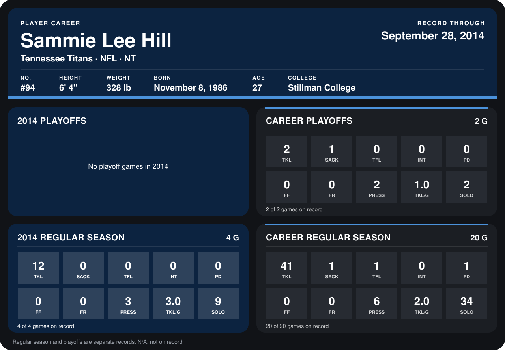

# Sammie Lee Hill

## Career stats

### Regular season

| Season | Club | G | TKL | SACK | TFL | INT | PD | FF | FR | PRESS | TKL/G | SOLO |
|---|---|---:|---:|---:|---:|---:|---:|---:|---:|---:|---:|---:|
| 2013 | Tennessee Titans | 16 | 29 | 1 | 1 | 0 | 1 | 0 | 0 | 3 | 1.8 | 25 |
| 2014 | Tennessee Titans | 4 | 12 | 0 | 0 | 0 | 0 | 0 | 0 | 3 | 3.0 | 9 |
| **Career** |  | 20 | 41 | 1 | 1 | 0 | 1 | 0 | 0 | 6 | 2.0 | 34 |

### Playoffs

| Season | Club | G | TKL | SACK | TFL | INT | PD | FF | FR | PRESS | TKL/G | SOLO |
|---|---|---:|---:|---:|---:|---:|---:|---:|---:|---:|---:|---:|
| 2013 | Tennessee Titans | 2 | 2 | 1 | 0 | 0 | 0 | 0 | 0 | 2 | 1.0 | 2 |
| **Career** |  | 2 | 2 | 1 | 0 | 0 | 0 | 0 | 0 | 2 | 1.0 | 2 |

## Awards

None on record.

Records through September 29, 2014. Identity: listed 2014 roster data, Weeks 1-4; number: 2014 Week 1 roster. [All Tennessee Titans players](README.md).
