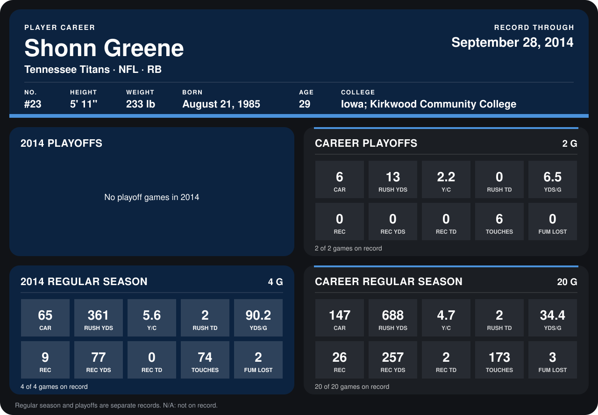

# Shonn Greene

## Career stats

### Regular season

| Season | Club | G | CAR | RUSH YDS | Y/C | RUSH TD | YDS/G | REC | REC YDS | REC TD | TOUCHES | FUM LOST |
|---|---|---:|---:|---:|---:|---:|---:|---:|---:|---:|---:|---:|
| 2013 | Tennessee Titans | 16 | 82 | 327 | 4.0 | 0 | 20.4 | 17 | 180 | 2 | 99 | 1 |
| 2014 | Tennessee Titans | 5 | 81 | 387 | 4.8 | 2 | 77.4 | 9 | 77 | 0 | 90 | 2 |
| **Career** |  | 21 | 163 | 714 | 4.4 | 2 | 34.0 | 26 | 257 | 2 | 189 | 3 |

### Playoffs

| Season | Club | G | CAR | RUSH YDS | Y/C | RUSH TD | YDS/G | REC | REC YDS | REC TD | TOUCHES | FUM LOST |
|---|---|---:|---:|---:|---:|---:|---:|---:|---:|---:|---:|---:|
| 2013 | Tennessee Titans | 2 | 6 | 13 | 2.2 | 0 | 6.5 | 0 | 0 | 0 | 6 | 0 |
| **Career** |  | 2 | 6 | 13 | 2.2 | 0 | 6.5 | 0 | 0 | 0 | 6 | 0 |

## Awards

None on record.

Records through October 5, 2014. Identity: listed 2014 roster data, Weeks 1-4; number: 2014 Week 1 roster. [All Tennessee Titans players](README.md).
