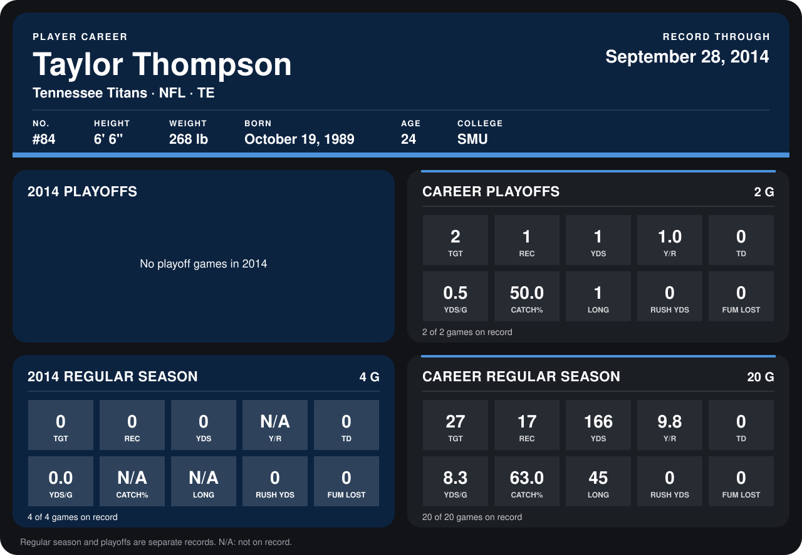

# Taylor Thompson

## Career stats

### Regular season

| Season | Team | Age | # | G | TGT | REC | YDS | Y/R | TD | YDS/G | CATCH% | LONG | RUSH YDS | FUM LOST |
|---|---|---:|---:|---:|---:|---:|---:|---:|---:|---:|---:|---:|---:|---:|
| 2013 | Tennessee Titans | 23 | 84 | 16 | 27 | 17 | 166 | 9.8 | 0 | 10.4 | 63.0 | 45 | 0 | 0 |
| 2014 | Tennessee Titans | 24 | 84 | 5 | 0 | 0 | 0 | N/A | 0 | 0.0 | N/A | N/A | 0 | 0 |
| **Career** |  |  |  | 21 | 27 | 17 | 166 | 9.8 | 0 | 7.9 | 63.0 | 45 | 0 | 0 |

### Playoffs

| Season | Team | Age | # | G | TGT | REC | YDS | Y/R | TD | YDS/G | CATCH% | LONG | RUSH YDS | FUM LOST |
|---|---|---:|---:|---:|---:|---:|---:|---:|---:|---:|---:|---:|---:|---:|
| 2013 | Tennessee Titans | 23 | 84 | 2 | 2 | 1 | 1 | 1.0 | 0 | 0.5 | 50.0 | 1 | 0 | 0 |
| **Career** |  |  |  | 2 | 2 | 1 | 1 | 1.0 | 0 | 0.5 | 50.0 | 1 | 0 | 0 |

## Awards

None on record.

Age is his age on the league's opening game of each season; # is the number listed for him that season with that team (2014: the card's rule; 2013: the 2013 season roster), N/A where no listing applies.

Records through October 5, 2014. Identity: listed 2014 roster data, Weeks 1-4; number: 2014 Week 1 roster. [All Tennessee Titans players](README.md).
