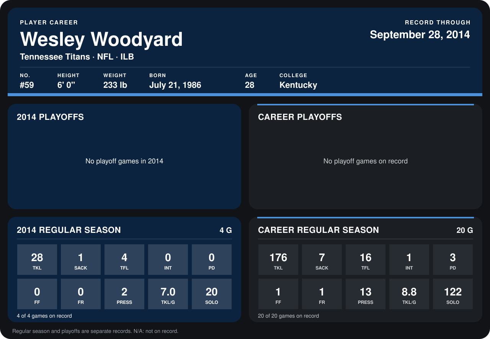

# Wesley Woodyard

## Career stats

### Regular season

| Season | Team | Age | # | G | TKL | SACK | TFL | INT | PD | FF | FR | PRESS | TKL/G | SOLO |
|---|---|---:|---:|---:|---:|---:|---:|---:|---:|---:|---:|---:|---:|---:|
| 2013 | Denver Broncos | 27 | 52 | 16 | 148 | 6 | 12 | 1 | 3 | 1 | 1 | 11 | 9.2 | 102 |
| 2014 | Tennessee Titans | 28 | 59 | 5 | 34 | 1 | 5 | 0 | 0 | 0 | 0 | 3 | 6.8 | 25 |
| **Career** |  |  |  | 21 | 182 | 7 | 17 | 1 | 3 | 1 | 1 | 14 | 8.7 | 127 |

### Playoffs

No playoff games on record.

## Awards

None on record.

Age is his age on the league's opening game of each season; # is the number listed for him that season with that team (2014: the card's rule; 2013: the 2013 season roster), N/A where no listing applies.

Records through October 5, 2014. Identity: listed 2014 roster data, Weeks 1-4; number: 2014 Week 1 roster. [All Tennessee Titans players](README.md).
