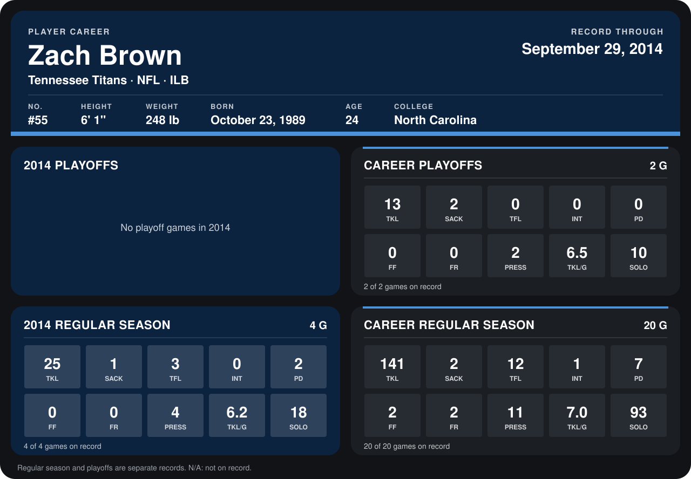

# Zach Brown

## Career stats

### Regular season

| Season | Team | Age | # | G | TKL | SACK | TFL | INT | PD | FF | FR | PRESS | TKL/G | SOLO |
|---|---|---:|---:|---:|---:|---:|---:|---:|---:|---:|---:|---:|---:|---:|
| 2013 | Tennessee Titans | 23 | 55 | 16 | 116 | 1 | 9 | 1 | 5 | 2 | 2 | 7 | 7.2 | 75 |
| 2014 | Tennessee Titans | 24 | 55 | 5 | 34 | 2 | 3 | 0 | 2 | 0 | 0 | 5 | 6.8 | 24 |
| **Career** |  |  |  | 21 | 150 | 3 | 12 | 1 | 7 | 2 | 2 | 12 | 7.1 | 99 |

### Playoffs

| Season | Team | Age | # | G | TKL | SACK | TFL | INT | PD | FF | FR | PRESS | TKL/G | SOLO |
|---|---|---:|---:|---:|---:|---:|---:|---:|---:|---:|---:|---:|---:|---:|
| 2013 | Tennessee Titans | 23 | 55 | 2 | 13 | 2 | 0 | 0 | 0 | 0 | 0 | 2 | 6.5 | 10 |
| **Career** |  |  |  | 2 | 13 | 2 | 0 | 0 | 0 | 0 | 0 | 2 | 6.5 | 10 |

## Awards

None on record.

Age is his age on the league's opening game of each season; # is the number listed for him that season with that team (2014: the card's rule; 2013: the 2013 season roster), N/A where no listing applies.

Records through October 5, 2014. Identity: listed 2014 roster data, Weeks 1-4; number: 2014 Week 1 roster. [All Tennessee Titans players](README.md).
