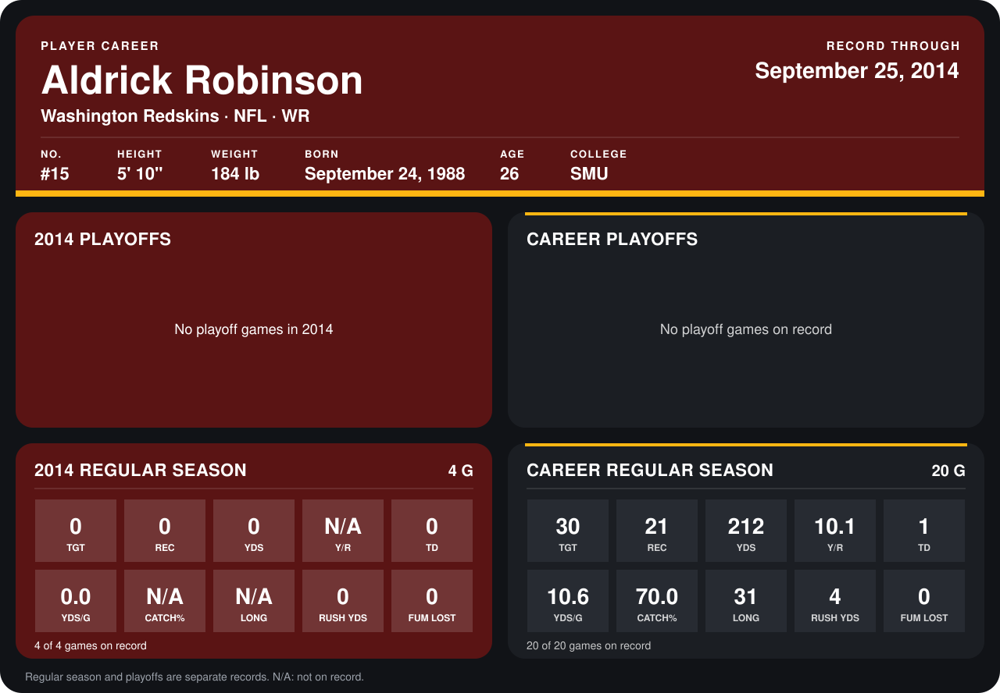

# Aldrick Robinson

## Career stats

### Regular season

| Season | Club | G | TGT | REC | YDS | Y/R | TD | YDS/G | CATCH% | LONG | RUSH YDS | FUM LOST |
|---|---|---:|---:|---:|---:|---:|---:|---:|---:|---:|---:|---:|
| 2013 | Washington Redskins | 16 | 30 | 21 | 212 | 10.1 | 1 | 13.2 | 70.0 | 31 | 4 | 0 |
| 2014 | Washington Redskins | 4 | 0 | 0 | 0 | N/A | 0 | 0.0 | N/A | N/A | 0 | 0 |
| **Career** |  | 20 | 30 | 21 | 212 | 10.1 | 1 | 10.6 | 70.0 | 31 | 4 | 0 |

### Playoffs

No playoff games on record.

## Awards

None on record.

Records through September 25, 2014. Identity: listed 2014 roster data, Weeks 1-4; number: 2014 Week 1 roster. [All Washington Redskins players](README.md).
