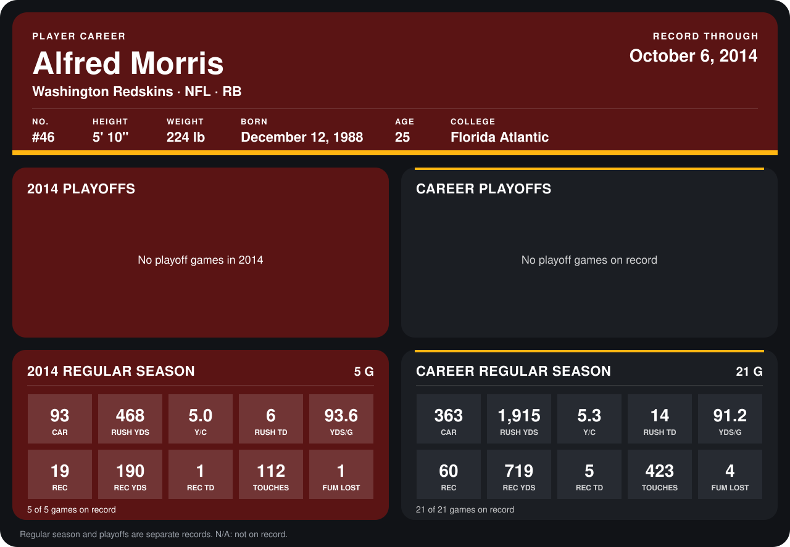

# Alfred Morris

## Career stats

### Regular season

| Season | Team | Age | # | G | CAR | RUSH YDS | Y/C | RUSH TD | YDS/G | REC | REC YDS | REC TD | TOUCHES | FUM LOST |
|---|---|---:|---:|---:|---:|---:|---:|---:|---:|---:|---:|---:|---:|---:|
| 2013 | Washington Redskins | 24 | 46 | 16 | 270 | 1,447 | 5.4 | 8 | 90.4 | 41 | 529 | 4 | 311 | 3 |
| 2014 | Washington Redskins | 25 | 46 | 4 | 73 | 387 | 5.3 | 5 | 96.8 | 14 | 158 | 1 | 87 | 1 |
| **Career** |  |  |  | 20 | 343 | 1,834 | 5.3 | 13 | 91.7 | 55 | 687 | 5 | 398 | 4 |

### Playoffs

No playoff games on record.

## Awards

- NFC Offensive Player of the Week (2013, Week 11)
- NFC Offensive Player of the Week (2013, Week 12)
- NFC Offensive Player of the Week (2014, Week 3)
- NFC Offensive Player of the Week (2014, Week 4)

Age is his age on the league's opening game of each season; # is the number listed for him that season with that team (2014: the card's rule; 2013: the 2013 season roster), N/A where no listing applies.

Records through September 25, 2014. Identity: listed 2014 roster data, Weeks 1-4; number: 2014 Week 1 roster. [All Washington Redskins players](README.md).
