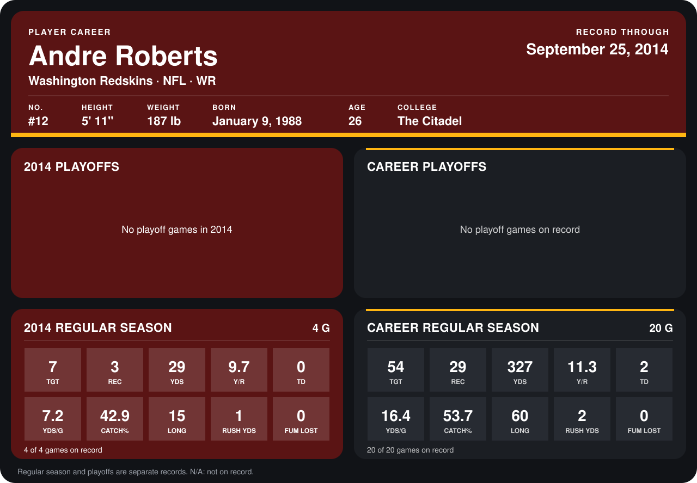

# Andre Roberts

## Career stats

### Regular season

| Season | Team | Age | # | G | TGT | REC | YDS | Y/R | TD | YDS/G | CATCH% | LONG | RUSH YDS | FUM LOST |
|---|---|---:|---:|---:|---:|---:|---:|---:|---:|---:|---:|---:|---:|---:|
| 2013 | Arizona Cardinals | 25 | 12 | 16 | 47 | 26 | 298 | 11.5 | 2 | 18.6 | 55.3 | 60 | 1 | 0 |
| 2014 | Washington Redskins | 26 | 12 | 4 | 7 | 3 | 29 | 9.7 | 0 | 7.2 | 42.9 | 15 | 1 | 0 |
| **Career** |  |  |  | 20 | 54 | 29 | 327 | 11.3 | 2 | 16.4 | 53.7 | 60 | 2 | 0 |

### Playoffs

No playoff games on record.

## Awards

None on record.

Age is his age on the league's opening game of each season; # is the number listed for him that season with that team (2014: the card's rule; 2013: the 2013 season roster), N/A where no listing applies.

Records through September 25, 2014. Identity: listed 2014 roster data, Weeks 1-4; number: 2014 Week 1 roster. [All Washington Redskins players](README.md).
