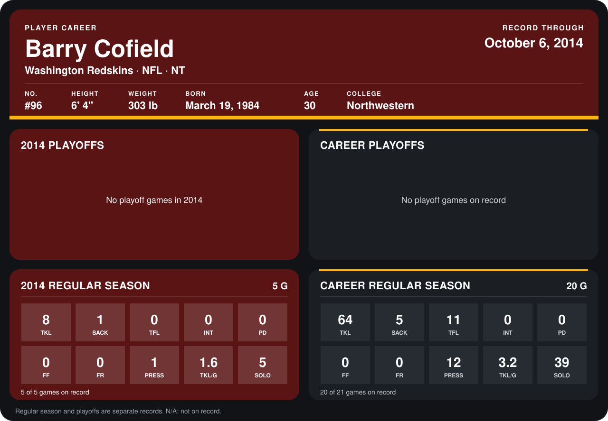

# Barry Cofield

## Career stats

### Regular season

| Season | Club | G | TKL | SACK | TFL | INT | PD | FF | FR | PRESS | TKL/G | SOLO |
|---|---|---:|---:|---:|---:|---:|---:|---:|---:|---:|---:|---:|
| 2013 | Washington Redskins | 15 | 56 | 4 | 11 | 0 | 0 | 0 | 0 | 11 | 3.7 | 34 |
| 2014 | Washington Redskins | 4 | 7 | 0 | 0 | 0 | 0 | 0 | 0 | 0 | 1.8 | 4 |
| **Career** |  | 19 | 63 | 4 | 11 | 0 | 0 | 0 | 0 | 11 | 3.3 | 38 |

### Playoffs

No playoff games on record.

## Awards

None on record.

Records through September 25, 2014. Identity: listed 2014 roster data, Weeks 1-4; number: 2014 Week 1 roster. [All Washington Redskins players](README.md).
