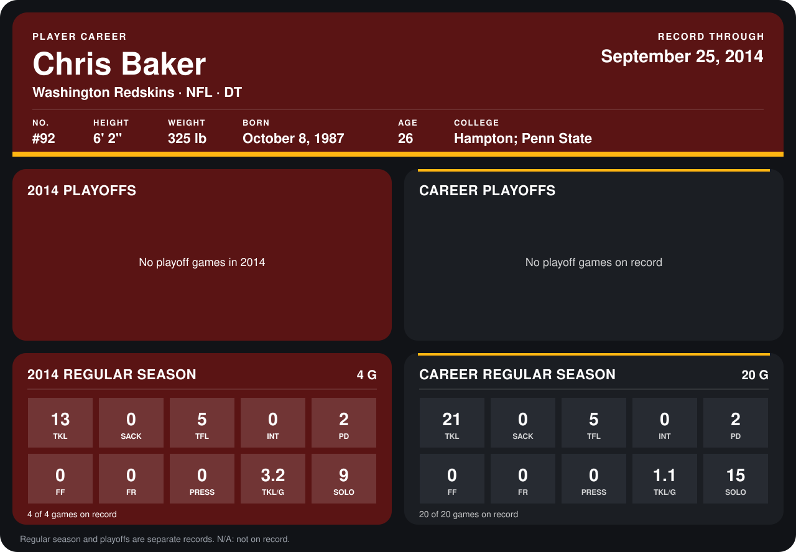

# Chris Baker

## Career stats

### Regular season

| Season | Club | G | TKL | SACK | TFL | INT | PD | FF | FR | PRESS | TKL/G | SOLO |
|---|---|---:|---:|---:|---:|---:|---:|---:|---:|---:|---:|---:|
| 2013 | Washington Redskins | 16 | 8 | 0 | 0 | 0 | 0 | 0 | 0 | 0 | 0.5 | 6 |
| 2014 | Washington Redskins | 5 | 15 | 0 | 5 | 0 | 2 | 0 | 0 | 0 | 3.0 | 9 |
| **Career** |  | 21 | 23 | 0 | 5 | 0 | 2 | 0 | 0 | 0 | 1.1 | 15 |

### Playoffs

No playoff games on record.

## Awards

None on record.

Records through October 6, 2014. Identity: listed 2014 roster data, Weeks 1-4; number: 2014 Week 1 roster. [All Washington Redskins players](README.md).
