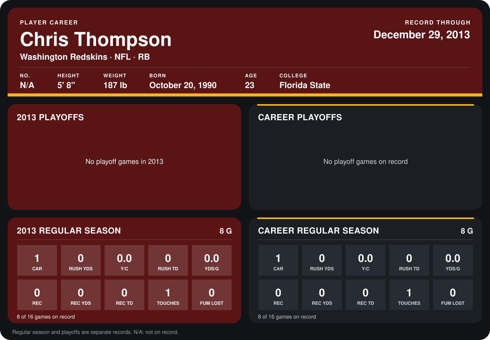

# Chris Thompson

## Career stats

### Regular season

| Season | Club | G | CAR | RUSH YDS | Y/C | RUSH TD | YDS/G | REC | REC YDS | REC TD | TOUCHES | FUM LOST |
|---|---|---:|---:|---:|---:|---:|---:|---:|---:|---:|---:|---:|
| 2013 | Washington Redskins | 8 | 1 | 0 | 0.0 | 0 | 0.0 | 0 | 0 | 0 | 1 | 0 |
| **Career** |  | 8 | 1 | 0 | 0.0 | 0 | 0.0 | 0 | 0 | 0 | 1 | 0 |

### Playoffs

No playoff games on record.

## Awards

- NFC Special Teams Player of the Week (2013, Week 8)
- NFC Special Teams Player of the Month (2013, October)

Records through September 29, 2014. Identity: the public player file's latest listing (no 2014 Weeks 1-4 roster row). [All Washington Redskins players](README.md).
