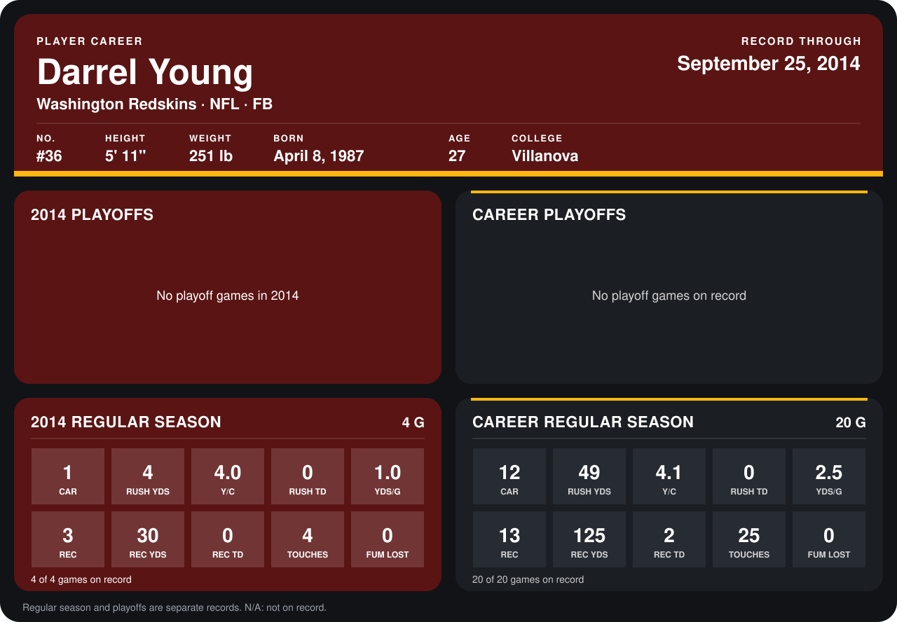

# Darrel Young

## Career stats

### Regular season

| Season | Club | G | CAR | RUSH YDS | Y/C | RUSH TD | YDS/G | REC | REC YDS | REC TD | TOUCHES | FUM LOST |
|---|---|---:|---:|---:|---:|---:|---:|---:|---:|---:|---:|---:|
| 2013 | Washington Redskins | 16 | 11 | 45 | 4.1 | 0 | 2.8 | 10 | 95 | 2 | 21 | 0 |
| 2014 | Washington Redskins | 5 | 1 | 4 | 4.0 | 0 | 0.8 | 4 | 44 | 0 | 5 | 0 |
| **Career** |  | 21 | 12 | 49 | 4.1 | 0 | 2.3 | 14 | 139 | 2 | 26 | 0 |

### Playoffs

No playoff games on record.

## Awards

None on record.

Records through October 6, 2014. Identity: listed 2014 roster data, Weeks 1-4; number: 2014 Week 1 roster. [All Washington Redskins players](README.md).
