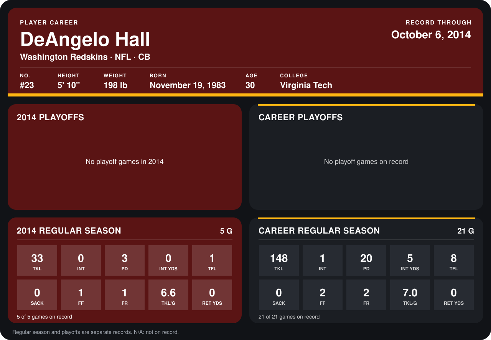

# DeAngelo Hall

## Career stats

### Regular season

| Season | Club | G | TKL | INT | PD | INT YDS | TFL | SACK | FF | FR | TKL/G | RET YDS |
|---|---|---:|---:|---:|---:|---:|---:|---:|---:|---:|---:|---:|
| 2013 | Washington Redskins | 16 | 115 | 1 | 17 | 5 | 7 | 0 | 1 | 1 | 7.2 | 0 |
| 2014 | Washington Redskins | 4 | 28 | 0 | 3 | 0 | 1 | 0 | 1 | 1 | 7.0 | 0 |
| **Career** |  | 20 | 143 | 1 | 20 | 5 | 8 | 0 | 2 | 2 | 7.2 | 0 |

### Playoffs

No playoff games on record.

## Awards

None on record.

Records through September 29, 2014. Identity: listed 2014 roster data, Weeks 1-4; number: 2014 Week 1 roster. [All Washington Redskins players](README.md).
