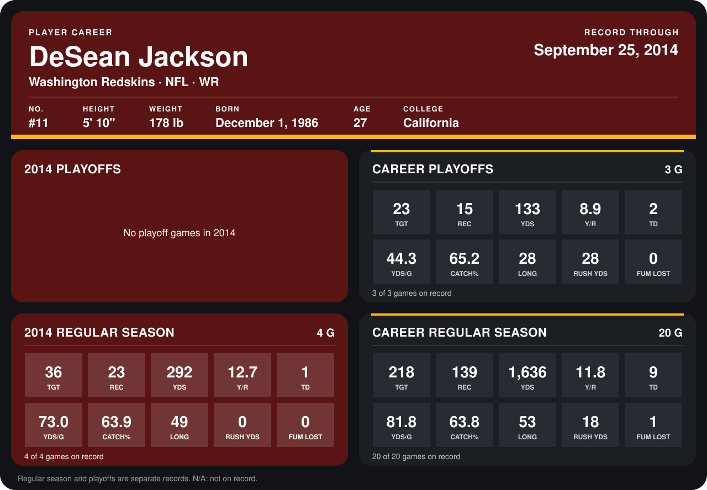

# DeSean Jackson

## Career stats

### Regular season

| Season | Club | G | TGT | REC | YDS | Y/R | TD | YDS/G | CATCH% | LONG | RUSH YDS | FUM LOST |
|---|---|---:|---:|---:|---:|---:|---:|---:|---:|---:|---:|---:|
| 2013 | Philadelphia Eagles | 16 | 182 | 116 | 1,344 | 11.6 | 8 | 84.0 | 63.7 | 53 | 18 | 1 |
| 2014 | Washington Redskins | 4 | 36 | 23 | 292 | 12.7 | 1 | 73.0 | 63.9 | 49 | 0 | 0 |
| **Career** |  | 20 | 218 | 139 | 1,636 | 11.8 | 9 | 81.8 | 63.8 | 53 | 18 | 1 |

### Playoffs

| Season | Club | G | TGT | REC | YDS | Y/R | TD | YDS/G | CATCH% | LONG | RUSH YDS | FUM LOST |
|---|---|---:|---:|---:|---:|---:|---:|---:|---:|---:|---:|---:|
| 2013 | Philadelphia Eagles | 3 | 23 | 15 | 133 | 8.9 | 2 | 44.3 | 65.2 | 28 | 28 | 0 |
| **Career** |  | 3 | 23 | 15 | 133 | 8.9 | 2 | 44.3 | 65.2 | 28 | 28 | 0 |

## Awards

- AP Second-Team All-Pro (2013, WR)
- Pro Bowl selection (2013, WR)

Records through September 25, 2014. Identity: listed 2014 roster data, Weeks 1-4; number: 2014 Week 1 roster. [All Washington Redskins players](README.md).
