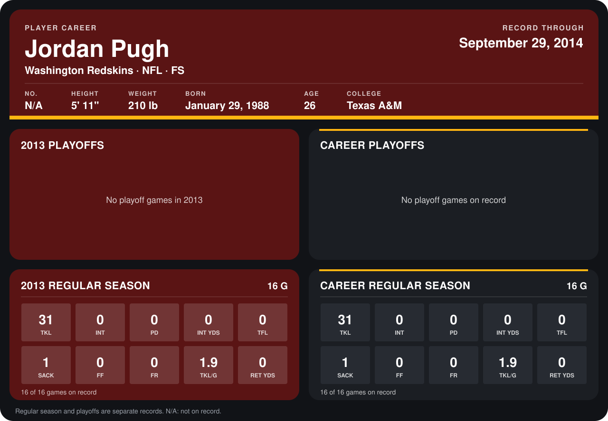

# Jordan Pugh

## Career stats

### Regular season

| Season | Club | G | TKL | INT | PD | INT YDS | TFL | SACK | FF | FR | TKL/G | RET YDS |
|---|---|---:|---:|---:|---:|---:|---:|---:|---:|---:|---:|---:|
| 2013 | Washington Redskins | 16 | 31 | 0 | 0 | 0 | 0 | 1 | 0 | 0 | 1.9 | 0 |
| **Career** |  | 16 | 31 | 0 | 0 | 0 | 0 | 1 | 0 | 0 | 1.9 | 0 |

### Playoffs

No playoff games on record.

## Awards

None on record.

Records through December 29, 2013. Identity: his listed 2013 season roster data (no 2014 Weeks 1-4 roster row). [All Washington Redskins players](README.md).
