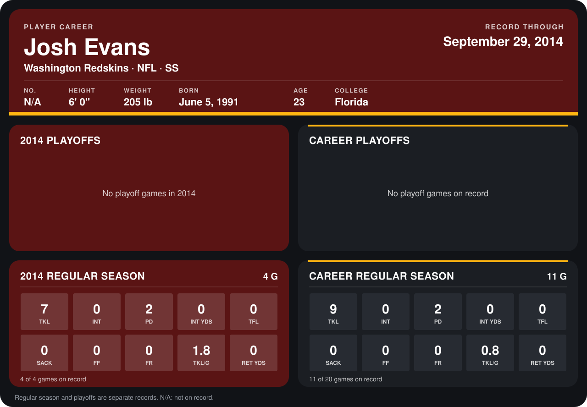

# Josh Evans

## Career stats

### Regular season

| Season | Club | G | TKL | INT | PD | INT YDS | TFL | SACK | FF | FR | TKL/G | RET YDS |
|---|---|---:|---:|---:|---:|---:|---:|---:|---:|---:|---:|---:|
| 2013 | Washington Redskins | 7 | 2 | 0 | 0 | 0 | 0 | 0 | 0 | 0 | 0.3 | 0 |
| 2014 | Washington Redskins | 4 | 7 | 0 | 2 | 0 | 0 | 0 | 0 | 0 | 1.8 | 0 |
| **Career** |  | 11 | 9 | 0 | 2 | 0 | 0 | 0 | 0 | 0 | 0.8 | 0 |

### Playoffs

No playoff games on record.

## Awards

None on record.

Records through September 25, 2014. Identity: listed 2014 roster data, Weeks 1-4. [All Washington Redskins players](README.md).
