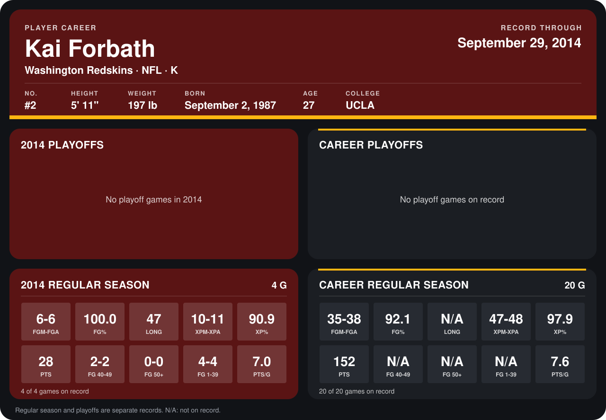

# Kai Forbath

## Career stats

### Regular season

| Season | Club | G | FGM-FGA | FG% | LONG | XPM-XPA | XP% | PTS | FG 40-49 | FG 50+ | FG 1-39 | PTS/G |
|---|---|---:|---:|---:|---:|---:|---:|---:|---:|---:|---:|---:|
| 2013 | Washington Redskins | 16 | 29-32 | 90.6 | N/A | 37-37 | 100.0 | 124 | N/A | N/A | N/A | 7.8 |
| 2014 | Washington Redskins | 4 | 6-6 | 100.0 | 47 | 10-11 | 90.9 | 28 | 2-2 | 0-0 | 4-4 | 7.0 |
| **Career** |  | 20 | 35-38 | 92.1 | N/A | 47-48 | 97.9 | 152 | N/A | N/A | N/A | 7.6 |

### Playoffs

No playoff games on record.

## Awards

- NFC Special Teams Player of the Month (2013, November)

Records through September 29, 2014. Identity: listed 2014 roster data, Weeks 1-4; number: 2014 Week 1 roster. [All Washington Redskins players](README.md).
