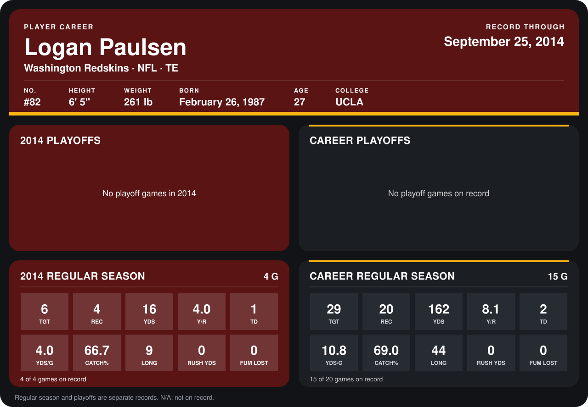

# Logan Paulsen

## Career stats

### Regular season

| Season | Club | G | TGT | REC | YDS | Y/R | TD | YDS/G | CATCH% | LONG | RUSH YDS | FUM LOST |
|---|---|---:|---:|---:|---:|---:|---:|---:|---:|---:|---:|---:|
| 2013 | Washington Redskins | 11 | 23 | 16 | 146 | 9.1 | 1 | 13.3 | 69.6 | 44 | 0 | 0 |
| 2014 | Washington Redskins | 4 | 6 | 4 | 16 | 4.0 | 1 | 4.0 | 66.7 | 9 | 0 | 0 |
| **Career** |  | 15 | 29 | 20 | 162 | 8.1 | 2 | 10.8 | 69.0 | 44 | 0 | 0 |

### Playoffs

No playoff games on record.

## Awards

None on record.

Records through September 29, 2014. Identity: listed 2014 roster data, Weeks 1-4; number: 2014 Week 1 roster. [All Washington Redskins players](README.md).
