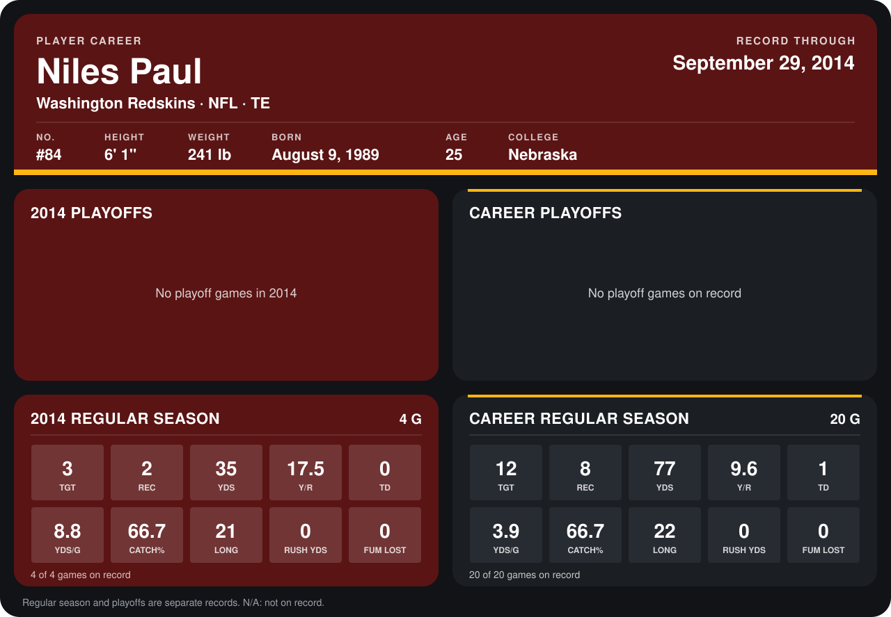

# Niles Paul

## Career stats

### Regular season

| Season | Club | G | TGT | REC | YDS | Y/R | TD | YDS/G | CATCH% | LONG | RUSH YDS | FUM LOST |
|---|---|---:|---:|---:|---:|---:|---:|---:|---:|---:|---:|---:|
| 2013 | Washington Redskins | 16 | 9 | 6 | 42 | 7.0 | 1 | 2.6 | 66.7 | 22 | 0 | 0 |
| 2014 | Washington Redskins | 5 | 4 | 2 | 35 | 17.5 | 0 | 7.0 | 50.0 | 21 | 0 | 0 |
| **Career** |  | 21 | 13 | 8 | 77 | 9.6 | 1 | 3.7 | 61.5 | 22 | 0 | 0 |

### Playoffs

No playoff games on record.

## Awards

None on record.

Records through October 6, 2014. Identity: listed 2014 roster data, Weeks 1-4; number: 2014 Week 1 roster. [All Washington Redskins players](README.md).
