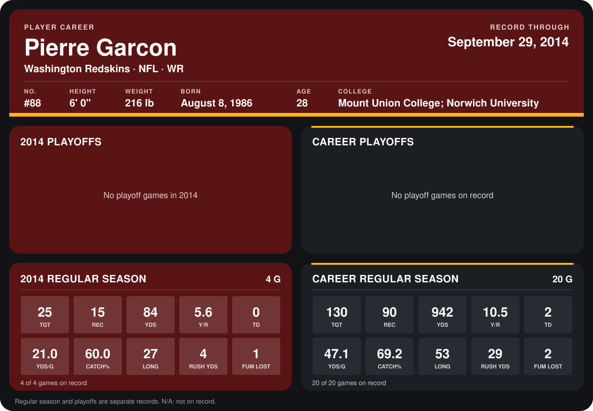

# Pierre Garcon

## Career stats

### Regular season

| Season | Club | G | TGT | REC | YDS | Y/R | TD | YDS/G | CATCH% | LONG | RUSH YDS | FUM LOST |
|---|---|---:|---:|---:|---:|---:|---:|---:|---:|---:|---:|---:|
| 2013 | Washington Redskins | 16 | 105 | 75 | 858 | 11.4 | 2 | 53.6 | 71.4 | 53 | 25 | 1 |
| 2014 | Washington Redskins | 4 | 25 | 15 | 84 | 5.6 | 0 | 21.0 | 60.0 | 27 | 4 | 1 |
| **Career** |  | 20 | 130 | 90 | 942 | 10.5 | 2 | 47.1 | 69.2 | 53 | 29 | 2 |

### Playoffs

No playoff games on record.

## Awards

None on record.

Records through September 29, 2014. Identity: listed 2014 roster data, Weeks 1-4; number: 2014 Week 1 roster. [All Washington Redskins players](README.md).
