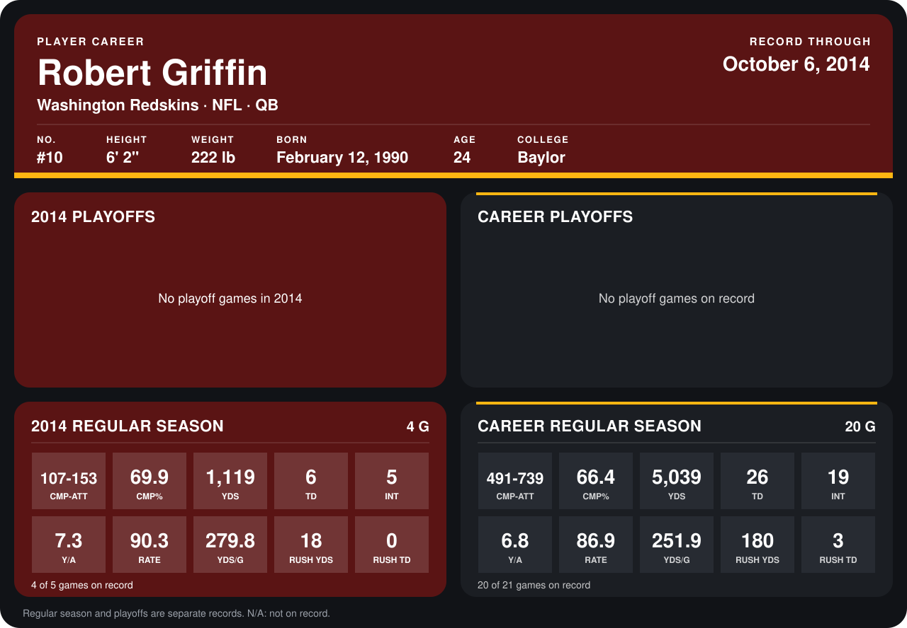

# Robert Griffin

## Career stats

### Regular season

| Season | Club | G | CMP-ATT | CMP% | YDS | TD | INT | Y/A | RATE | YDS/G | RUSH YDS | RUSH TD |
|---|---|---:|---:|---:|---:|---:|---:|---:|---:|---:|---:|---:|
| 2013 | Washington Redskins | 16 | 384-586 | 65.5 | 3,920 | 20 | 14 | 6.7 | 86.0 | 245.0 | 162 | 3 |
| 2014 | Washington Redskins | 3 | 82-114 | 71.9 | 828 | 5 | 3 | 7.3 | 95.9 | 276.0 | 17 | 0 |
| **Career** |  | 19 | 466-700 | 66.6 | 4,748 | 25 | 17 | 6.8 | 87.6 | 249.9 | 179 | 3 |

### Playoffs

No playoff games on record.

## Awards

None on record.

Records through September 29, 2014. Identity: listed 2014 roster data, Weeks 1-4; number: 2014 Week 1 roster. [All Washington Redskins players](README.md).
